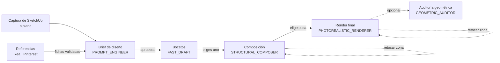
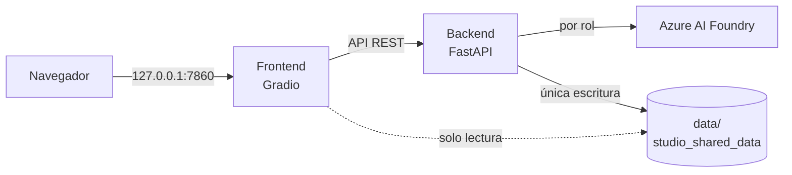

# InteriorAI

[](https://github.com/SergioVelmay/InteriorAI/actions/workflows/ci.yml)
[](LICENSE)


Estudio de interiorismo asistido por IA con **supervisión humana en cada etapa**
(Human-in-the-Loop). A partir de una captura de SketchUp (o un plano) y referencias de muebles e
inspiración, genera un brief de diseño, bocetos, una composición y un render fotorrealista de
cada habitación. **Nada avanza sin tu aprobación** y cada acción con coste lo muestra antes.

Construido con FastAPI, Gradio y Azure AI Foundry. Versión **1.0.0** ([CHANGELOG](CHANGELOG.md)).

## Cómo funciona



1. **Assets:** subes la captura de SketchUp (o un plano en imagen) y tus referencias; la IA
   propone una ficha de cada referencia (medidas, materiales, colores) y tú la corriges y validas.
2. **Brief:** la IA redacta el diseño (restricciones, mobiliario con medidas, paleta, materiales,
   luz y los prompts de imagen). Lo editas, lo apruebas o lo rechazas con comentarios.
3. **Bocetos → composición → render final:** cada etapa parte de la imagen que **tú** eliges en
   la anterior. Puedes descartar, rechazar con comentarios (y regenerar) o **retocar una zona**
   con el pincel: fuera de lo pintado, la imagen queda idéntica.
4. **Auditoría (opcional):** compara el render con la captura (proporciones, geometría,
   mobiliario) y propone correcciones que puedes aplicar al regenerar.
5. **Costes:** cada llamada queda registrada; la pestaña Costes muestra el gasto por rol, día y
   proyecto, y el visor indica cuánto ha costado llegar a cada imagen.

### Roles de IA

El código nunca usa nombres de modelos: cada tarea es un **rol** y su despliegue se configura en
`.env` (`DEPLOYMENT_ROLE_*`).

| Rol | Tarea |
|-----|-------|
| `CONTEXT_MANAGER` | Fichas de las referencias (medidas, materiales, colores) |
| `PROMPT_ENGINEER` | Brief de diseño y prompts de imagen |
| `FAST_DRAFT` | Bocetos rápidos sobre la captura |
| `STRUCTURAL_COMPOSER` | Composición fiel a la geometría; retoques con máscara |
| `PHOTOREALISTIC_RENDERER` | Render final fotorrealista con las referencias |
| `GEOMETRIC_AUDITOR` | Auditoría del render frente a la captura |

### Costes orientativos

Precios de lista en `config/pricing.yaml` (estimados; la cifra real está en Azure Cost
Management). Observados en las pruebas reales:

| Acción | Coste aproximado |
|--------|------------------|
| Brief de diseño | 0,02-0,05 € |
| Boceto (por imagen) | 0,015 € |
| Composición | 0,03 € |
| Render final 1920 px | 0,09 € |
| Retoque de una zona del render final | 0,09 € |
| Auditoría geométrica | 0,15-0,25 € |

Un salón completo, con varias iteraciones, retoques y una auditoría, costó unos **0,62 €**. En
modo `azure`, las acciones de más de 0,05 € piden un segundo clic de confirmación.

## Arquitectura



- **Backend** (FastAPI, async): única vía de escritura en `data/` (JSON atómico y bloqueo por
  proyecto) y única vía a la IA (`FoundryClient`, con telemetría de costes). Modo `mock` sin
  credenciales.
- **Frontend** (Gradio, tema oscuro): sin credenciales; lee las imágenes del volumen en solo
  lectura y escribe a través de la API.
- **Datos:** un proyecto por carpeta (`metadatos.json`, assets, histórico de renders y
  telemetría). El borrado es suave: pasa a `data/.papelera/`.

Más detalle técnico en [AGENTS.md](AGENTS.md) y [docs/agent/](docs/agent/); la historia del
proyecto, paso a paso, en [docs/pasos/](docs/pasos/README.md).

## Puesta en marcha

Requisitos: Docker Desktop (o Docker Engine + Compose v2).

```bash
git clone https://github.com/SergioVelmay/InteriorAI.git && cd InteriorAI
cp .env.example .env      # funciona tal cual en modo mock (sin coste ni credenciales)
mkdir -p data             # tus proyectos; nunca se sube a git
docker compose up --build -d
```

| Servicio | URL |
|----------|-----|
| Interfaz | http://127.0.0.1:7860 |
| API (Swagger) | http://127.0.0.1:8000/docs |

Para usar Azure, rellena en `.env` el endpoint, la clave, los despliegues de cada rol y pon
`AI_PROVIDER_MODE=azure`; después, `docker compose up -d backend`. En Linux, si tu usuario no es
el 1000, ajusta `APP_UID`/`APP_GID` (`id -u`, `id -g`).

Los contenedores se ejecutan sin privilegios, con el sistema de archivos en solo lectura, sin
capacidades y con límites de memoria y CPU; los puertos solo escuchan en `127.0.0.1`.

### Mantenimiento

```bash
docker compose exec backend python -m app.storage listar
docker compose exec backend python -m app.storage papelera listar
docker compose exec backend python -m app.storage papelera restaurar <entrada>
docker compose exec backend python -m app.storage papelera vaciar --dias 30   # pide confirmación
```

## Desarrollo

Requisitos: [uv](https://docs.astral.sh/uv/) (instala Python 3.11).

```bash
uv sync
uvx pre-commit install    # gitleaks, bloqueo de .env y de data/, ruff
uv run pytest             # tests (modo mock)
uv run ruff check . && uv run ruff format --check .
```

Pruebas de extremo a extremo con la app levantada en modo mock (crean proyectos «E2E …» y los
mueven a la papelera al terminar):

```bash
postman collection run postman/interiorai.postman_collection.json \
  -e postman/local.postman_environment.json --working-dir postman
uv run --group e2e playwright install chromium   # una vez
uv run --group e2e pytest e2e                    # o --browser-channel msedge
```

La CI (GitHub Actions) ejecuta en cada Pull Request lint, tests, gitleaks sobre todo el
historial, la construcción de las imágenes, la colección de Postman (con newman) y las pruebas de
Playwright, siempre en modo mock y sin secretos. `main` solo acepta cambios por Pull Request con
la CI en verde.

## Seguridad

Repositorio público: los secretos solo viven en `.env` (nunca versionado). Cómo avisar de una
vulnerabilidad: [SECURITY.md](SECURITY.md).

## Licencia

[MIT](LICENSE) © 2026 Sergio Velasco
