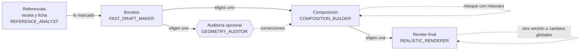
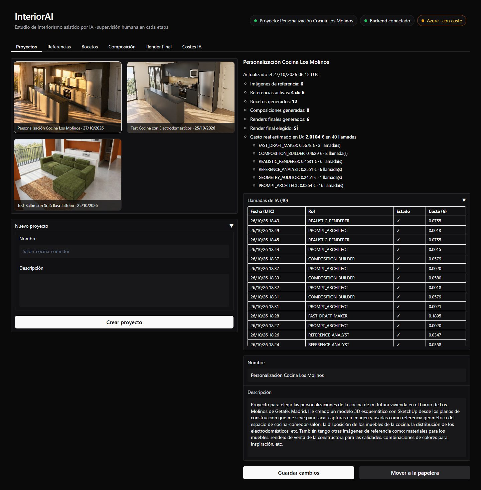
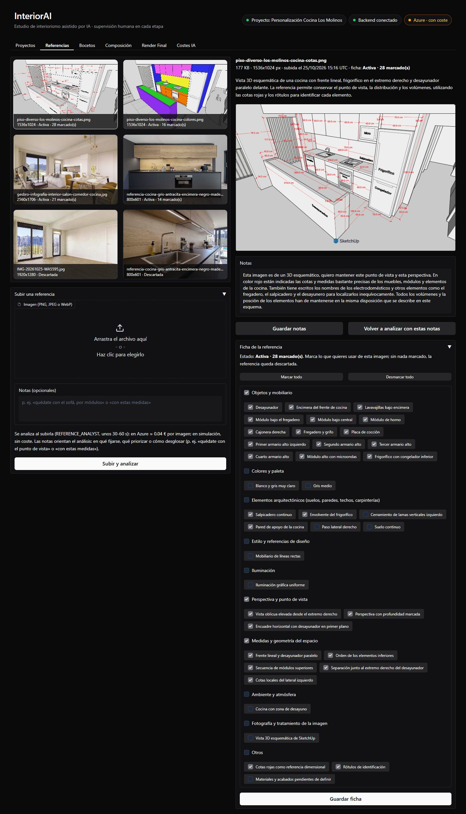
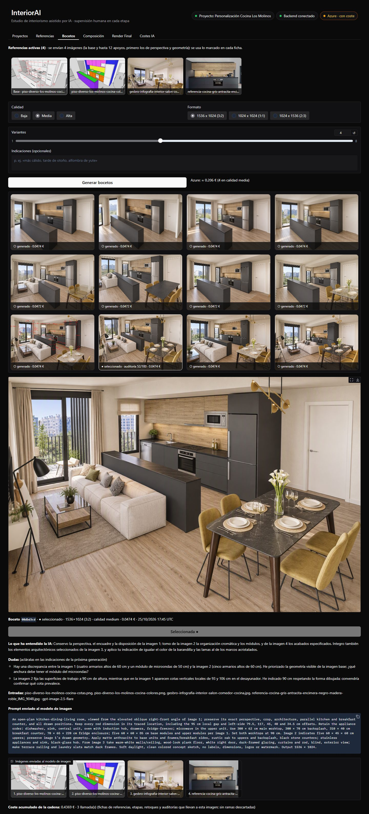
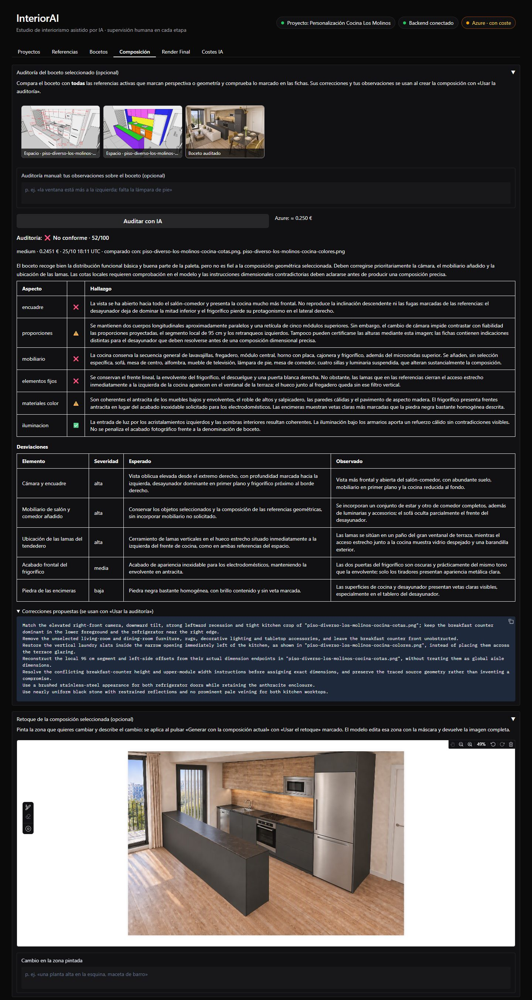
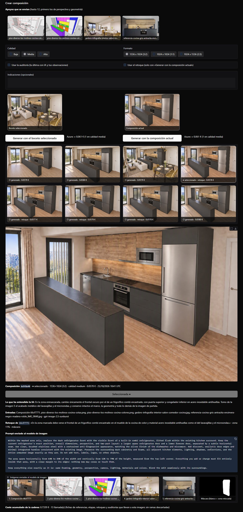
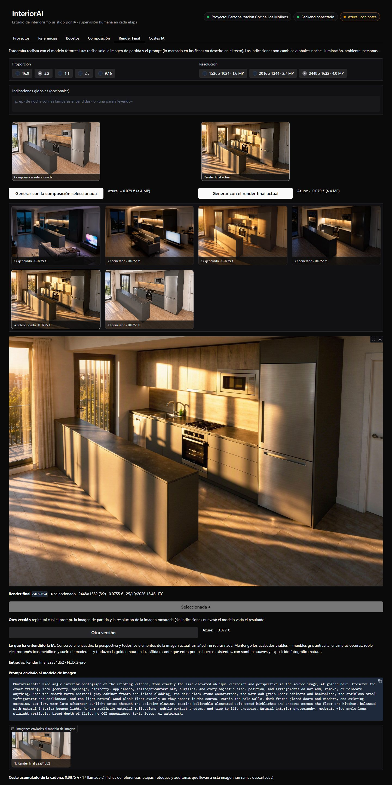
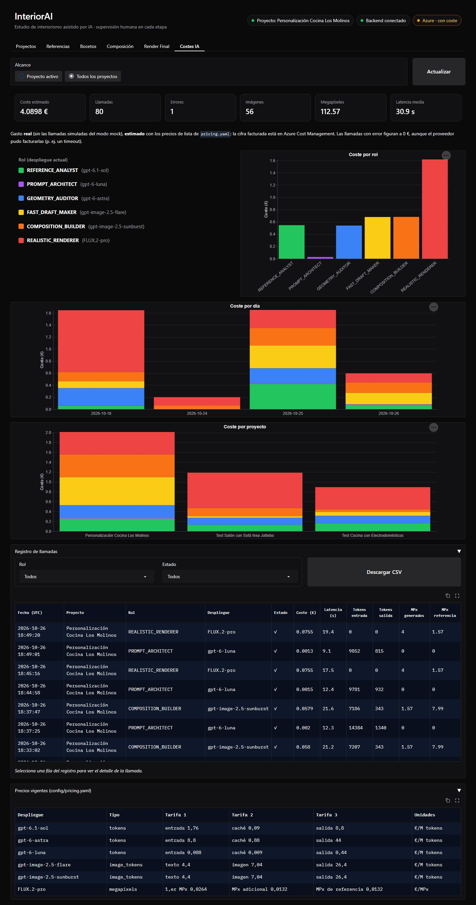
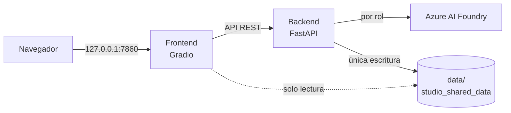

# InteriorAI

[](https://github.com/SergioVelmay/InteriorAI/actions/workflows/ci.yml)
[](LICENSE)


Estudio de interiorismo asistido por IA con **supervisión humana en cada etapa**
(Human-in-the-Loop). A partir de tus referencias (vistas de la estancia, capturas de SketchUp,
planos, muebles e inspiración) genera bocetos, una composición fiel y una fotografía realista de
cada habitación. **Nada avanza sin tu elección** y cada acción con coste lo muestra antes.

Construido con FastAPI, Gradio y Azure AI Foundry. Versión **3.0.0** ([CHANGELOG](CHANGELOG.md)).

📖 **Documentación:** <https://sergiovelmay.github.io/InteriorAI/> (instalación, configuración,
manual de usuario y referencia técnica).

## Cómo funciona



1. **Referencias:** subes cada imagen con sus notas («quédate con el sofá», «con estas
   medidas»…) y la IA la analiza al momento: una **receta** con lo útil de la imagen en 12 grupos
   (objetos, colores, materiales, perspectiva, geometría, luz…), con medidas y su origen. En la
   **ficha** marcas lo que quieres usar; solo cuenta lo marcado.
2. **Bocetos:** exploraciones rápidas a partir de las referencias activas (la que marca la
   perspectiva es la imagen base). Eliges uno.
3. **Composición:** materializa el boceto con fidelidad, con la ayuda de una **auditoría**
   opcional frente a las referencias de perspectiva y geometría (y tus observaciones) y de
   **retoques con máscara**: pintas una zona y describes el cambio. Eliges una.
4. **Render final:** la fotografía realista, con cambios globales en texto libre (noche,
   iluminación, ambiente, personas), proporción y resolución hasta 4 MP, y «otra versión» con el
   mismo prompt.
5. **Prompts automáticos:** en cada generación, el PROMPT_ARCHITECT escribe el prompt con las
   entradas reales y te explica lo que ha entendido y sus dudas.
6. **Costes IA:** cada llamada queda registrada con su coste; la pestaña muestra el gasto por rol,
   día y proyecto, y cada imagen indica cuánto ha costado llegar a ella.

### Recorrido

Un caso real, de principio a fin: la personalización de una cocina abierta al salón. Cada
captura es una pestaña completa, con sus secciones desplegadas.

<details>
<summary><strong>Proyectos</strong>: galería, resumen con el gasto por rol y llamadas de IA</summary>


</details>

<details>
<summary><strong>Referencias</strong>: la imagen, tus notas y la ficha con lo que se usa</summary>


</details>

<details>
<summary><strong>Bocetos</strong>: lo que se envía, las variantes y el boceto elegido con su prompt</summary>


</details>

<details>
<summary><strong>Composición</strong>: auditoría del boceto, retoque con máscara y la composición elegida</summary>




</details>

<details>
<summary><strong>Render final</strong>: la fotografía realista y lo que ha costado llegar a ella</summary>


</details>

<details>
<summary><strong>Costes IA</strong>: gasto por rol, día y proyecto, registro de llamadas y precios</summary>


</details>

### Roles de IA

El código nunca usa nombres de modelos: cada tarea es un **rol** y su despliegue se configura en
`.env` (`DEPLOYMENT_ROLE_*`), con su esfuerzo de razonamiento (`<ROL>_REASONING_EFFORT`).

| Rol | Tarea |
|-----|-------|
| `REFERENCE_ANALYST` | Receta de cada referencia (una vez por imagen) |
| `PROMPT_ARCHITECT` | Prompt de cada generación, con lo que ha entendido y sus dudas |
| `FAST_DRAFT_MAKER` | Bocetos en lote a partir de las referencias activas |
| `COMPOSITION_BUILDER` | Composición fiel y retoques con máscara (el único con máscara) |
| `REALISTIC_RENDERER` | Fotografía realista y cambios globales, sin máscara |
| `GEOMETRY_AUDITOR` | Auditoría del boceto frente a las referencias del espacio |

### Costes orientativos

Precios de lista en `config/pricing.yaml` (estimados; la cifra real está en Azure Cost
Management). Medidos en las pruebas reales de las versiones 2.0.0 y 3.0.0:

| Acción | Coste aproximado |
|--------|------------------|
| Receta de una referencia | 0,03-0,05 € |
| Prompt automático de una generación | 0,001-0,002 € |
| 4 bocetos en calidad media (3-4 imágenes de entrada) | 0,14-0,19 € |
| Composición o retoque (4-5 imágenes de entrada) | 0,05-0,06 € |
| Render final a 4 MP | 0,08 € |
| Auditoría del boceto | 0,14-0,25 € (razonamiento `medium`) |

En los modelos de bocetos pesan más las imágenes de entrada que las generadas. En modo `azure`,
las acciones de más de 0,20 € piden un segundo clic de confirmación junto al botón.

## Arquitectura



- **Backend** (FastAPI, async): única vía de escritura en `data/` (JSON atómico y bloqueo por
  proyecto) y única vía a la IA (`FoundryClient`, con telemetría de costes). Modo `mock` sin
  credenciales.
- **Frontend** (Gradio, tema oscuro): sin credenciales; lee las imágenes del volumen en solo
  lectura y escribe a través de la API.
- **Datos:** un proyecto por carpeta (`metadatos.json`, referencias, histórico de renders y
  telemetría en `costes_telemetria.jsonl`). El borrado es suave: pasa a `data/.papelera/`.

Más detalle técnico en [AGENTS.md](AGENTS.md) y [docs/agent/](docs/agent/); la historia del
proyecto, paso a paso, en [docs/pasos/](docs/pasos/README.md).

## Puesta en marcha

Requisitos: Docker Desktop (o Docker Engine + Compose v2).

```bash
git clone https://github.com/SergioVelmay/InteriorAI.git && cd InteriorAI
cp .env.example .env      # funciona tal cual en modo mock (sin coste ni credenciales)
mkdir -p data             # tus proyectos; nunca se sube a git
docker compose up --build -d
```

| Servicio | URL |
|----------|-----|
| Interfaz | http://127.0.0.1:7860 |
| API (Swagger) | http://127.0.0.1:8000/docs |

Para usar Azure, rellena en `.env` el endpoint, la clave, los despliegues de cada rol y pon
`AI_PROVIDER_MODE=azure`; después, `docker compose up -d backend`. En Linux, si tu usuario no es
el 1000, ajusta `APP_UID`/`APP_GID` (`id -u`, `id -g`).

**Desde la 2.x:** la 3.0.0 renombra los roles y sus variables del `.env`
(`DEPLOYMENT_ROLE_*`, `*_REASONING_EFFORT`, `GEOMETRY_AUDITOR_TIMEOUT_S`). Renómbralas según esta
tabla; si queda alguna con el nombre anterior, la aplicación avisa al arrancar y no la usa:

| Antes (hasta la 2.0.0) | Desde la 3.0.0 |
|------------------------|----------------|
| `PROMPT_ENGINEER` | `PROMPT_ARCHITECT` |
| `FAST_DRAFT` | `FAST_DRAFT_MAKER` |
| `STRUCTURAL_COMPOSER` | `COMPOSITION_BUILDER` |
| `PHOTOREALISTIC_RENDERER` | `REALISTIC_RENDERER` |
| `GEOMETRIC_AUDITOR` | `GEOMETRY_AUDITOR` |
| `REFERENCE_ANALYST` | (sin cambios) |

**Desde la 3.x:** los datos se migran solos al esquema v3 al arrancar (cada proyecto conserva una
copia en `metadatos.v2.json`). Las imágenes de la v1 siguen en sus galerías como imágenes
sueltas, sin su brief. **Desde la 1.0.0:** actualiza antes con la 3.0.0 (la 4.0.0 ya no lee
esos datos).

Los contenedores se ejecutan sin privilegios, con el sistema de archivos en solo lectura, sin
capacidades y con límites de memoria y CPU; los puertos solo escuchan en `127.0.0.1`.

### Mantenimiento

```bash
docker compose exec backend python -m app.storage listar
docker compose exec backend python -m app.storage papelera listar
docker compose exec backend python -m app.storage papelera restaurar <entrada>
docker compose exec backend python -m app.storage papelera vaciar --dias 30   # pide confirmación
```

## Desarrollo

Requisitos: [uv](https://docs.astral.sh/uv/) (instala Python 3.11).

```bash
uv sync
uvx pre-commit install    # gitleaks, bloqueo de .env y de data/, ruff
uv run pytest             # tests (modo mock)
uv run ruff check . && uv run ruff format --check .
```

Pruebas de extremo a extremo con la app levantada en modo mock (crean proyectos «E2E …» y los
mueven a la papelera al terminar):

```bash
postman collection run postman/interiorai.postman_collection.json \
  -e postman/local.postman_environment.json --working-dir postman
uv run --group e2e playwright install chromium   # una vez
uv run --group e2e pytest e2e                    # o --browser-channel msedge
```

La CI (GitHub Actions) ejecuta en cada Pull Request lint, tests, gitleaks sobre todo el
historial, la construcción de las imágenes, la colección de Postman (con newman) y las pruebas de
Playwright, siempre en modo mock y sin secretos. `main` solo acepta cambios por Pull Request con
la CI en verde.

## Seguridad

Repositorio público: los secretos solo viven en `.env` (nunca versionado). Cómo avisar de una
vulnerabilidad: [SECURITY.md](SECURITY.md).

## Licencia

[MIT](LICENSE) © 2026 Sergio Velasco
