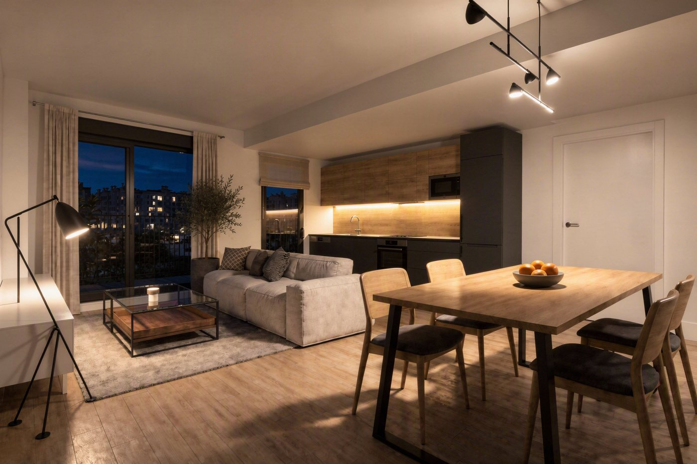
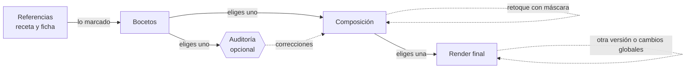

---
hide:
  - navigation
---

# InteriorAI

**Estudio de interiorismo asistido por IA con supervisión humana en cada etapa.** A partir de tus
referencias (vistas de la estancia, capturas de SketchUp, planos, muebles e inspiración),
InteriorAI genera bocetos, una composición fiel y una fotografía realista de cada habitación.
**Nada avanza sin tu elección** y cada acción con coste te lo muestra antes.

Software libre (licencia MIT), construido con FastAPI, Gradio y Azure AI Foundry. Funciona en tu
equipo con Docker y tiene un modo de **simulación sin coste** para probarlo sin credenciales.

-   :material-rocket-launch: **Primeros pasos**

    ---

    Instala InteriorAI con Docker, pruébalo en simulación y conéctalo a tu Azure AI Foundry.

    [:octicons-arrow-right-24: Instalación](primeros-pasos/instalacion.md)

-   :material-book-open-variant: **Manual de usuario**

    ---

    Un caso completo, de las referencias al render final, con cada pestaña y cada opción.

    [:octicons-arrow-right-24: Manual](manual/index.md)

-   :material-api: **Referencia técnica**

    ---

    Arquitectura, API REST con Swagger, modelo de datos, roles de IA y costes.

    [:octicons-arrow-right-24: Referencia](referencia/index.md)

-   :material-tag-multiple: **Versiones**

    ---

    Qué trae cada versión y cómo actualizar desde las anteriores.

    [:octicons-arrow-right-24: Versiones](proyecto/versiones.md)

## Cómo funciona

1. **Referencias.** Subes cada imagen con tus notas («quédate con el sofá», «con estas
   medidas»…) y la IA la analiza: una **receta** con lo útil de la imagen en 12 grupos (objetos,
   colores, materiales, perspectiva, geometría, luz…), con medidas y su origen. En la **ficha**
   marcas lo que quieres usar; solo cuenta lo marcado.
2. **Bocetos.** Exploraciones rápidas a partir de las referencias activas. Eliges uno.
3. **Composición.** Materializa el boceto con fidelidad, con una **auditoría** opcional frente a
   las referencias del espacio y **retoques con máscara**: pintas una zona y describes el cambio.
   Eliges una.
4. **Render final.** La fotografía realista, con cambios globales en texto libre (noche,
   iluminación, ambiente, personas), proporción y resolución hasta 4 MP.
5. **Prompts automáticos.** En cada generación, la IA escribe el prompt con las entradas reales y
   te explica lo que ha entendido.
6. **Costes.** Cada llamada queda registrada con su coste: por rol, día y proyecto, y lo que ha
   costado llegar a cada imagen.

## Principios

- **Supervisión humana (Human-in-the-Loop).** Cada etapa parte de la imagen que tú eliges en la
  anterior; la IA nunca selecciona por ti.
- **Sin sorpresas de coste.** Cada botón con coste muestra una estimación y, por encima de
  0,20 €, pide un segundo clic de confirmación.
- **Tus datos son tuyos.** Todo se guarda en tu equipo (`data/`); el borrado es suave y pasa por
  una papelera.
- **Seguro por defecto.** Contenedores sin privilegios, puertos solo en `127.0.0.1` y los
  secretos solo en tu `.env`.
