# 3. Bocetos

Los bocetos son **exploraciones rápidas** del espacio a partir de las referencias activas: sirven
para decidir la composición general, los colores y los materiales antes de afinar. La pestaña se
desbloquea en cuanto hay alguna referencia activa.

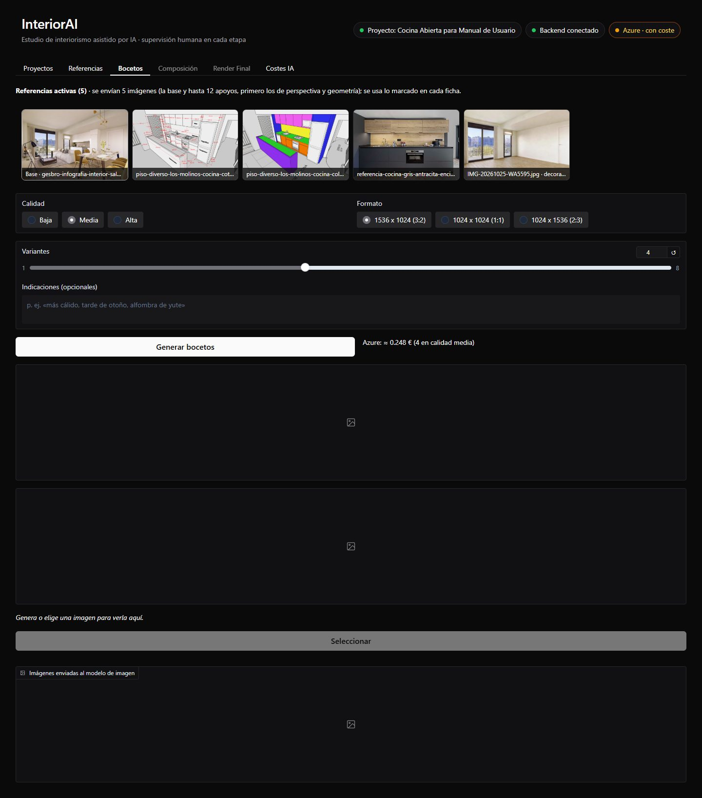

## Lo que recibe el modelo

Arriba se ven las **referencias activas** que se enviarán, en orden: primero la **imagen base**
(la que tiene la perspectiva marcada) y después los apoyos. Si hubiera más de las que caben, las
sobrantes aparecerían con el pie en rojo.

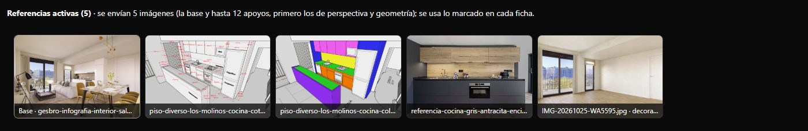

## Opciones

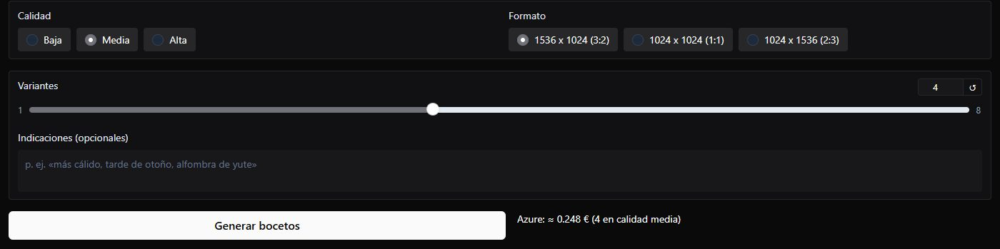

| Opción | Uso |
|--------|-----|
| **Calidad** | Baja, media o alta. Media es un buen equilibrio; alta tarda y cuesta más |
| **Formato** | Horizontal 3:2 (1536 × 1024), cuadrado o vertical |
| **Variantes** | De 1 a 8 imágenes por tanda (4 por defecto): todas con el mismo prompt, el modelo varía el resultado |
| **Indicaciones** | Lo que quieres en esta tanda, en texto libre (opcional) |

Junto al botón se ve la **estimación del coste**, que cambia con las variantes y la calidad. En
modo Azure, si pasa de 0,20 €, el botón pide una **confirmación** en rojo antes de llamar a la IA:

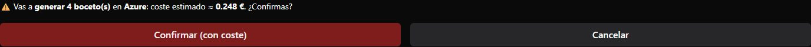

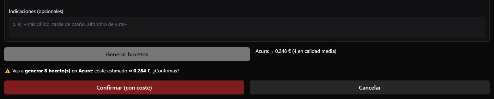

**Cancelar** no tiene coste. Mientras trabaja la IA, se ve «procesando» con el tiempo transcurrido
y el previsto:

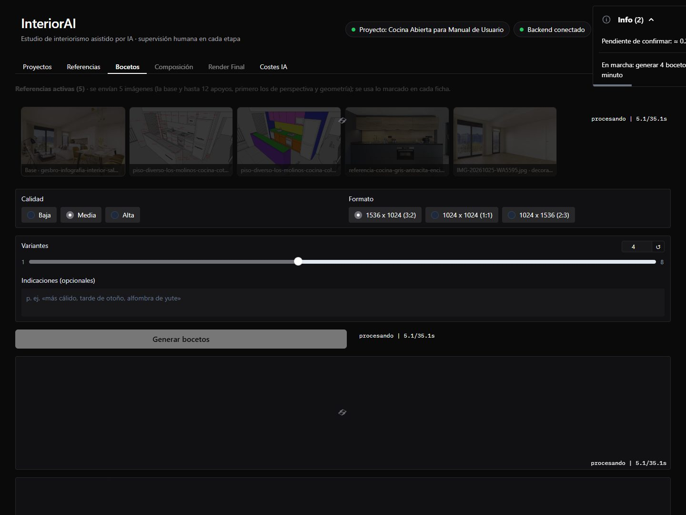

## Qué pasa al generar

1. El `PROMPT_ARCHITECT` escribe el prompt de esa tanda con todo lo anterior: la descripción del
   proyecto, el papel de cada imagen, lo marcado (y lo no marcado) de cada ficha y tus
   indicaciones.
2. El `FAST_DRAFT_MAKER` genera las variantes.
3. Aparecen en la galería, **sin seleccionar**: eliges tú.

En el caso se hicieron dos tandas de 4 en calidad media (unos 0,24 € cada una): la primera sin
indicaciones y la segunda con estas:

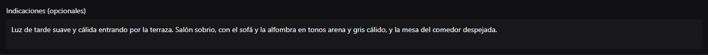

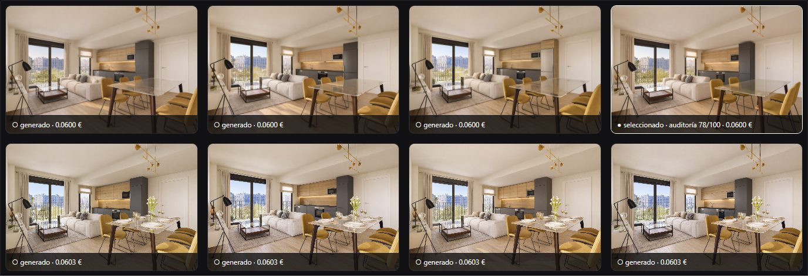

Todas conservan la vista de la infografía, con la cocina antracita y roble sin desayunador; las de
la segunda tanda dejan la mesa del comedor despejada, como pedían las indicaciones.

## Elegir un boceto

Al hacer clic en una miniatura se ve en grande, en su proporción, con su línea de datos (estado,
tamaño, calidad, coste y fecha). **Seleccionar** la elige: es la que usará la composición. Solo
hay **una seleccionada por etapa**; al elegir otra, la anterior deja de estarlo.

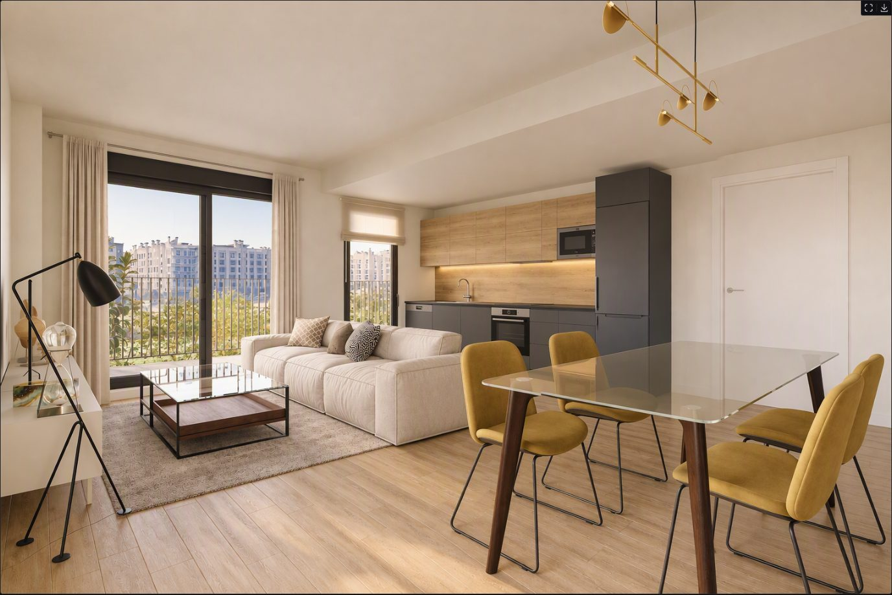

## La trazabilidad de cada imagen

Debajo de la imagen está todo lo que la explica:

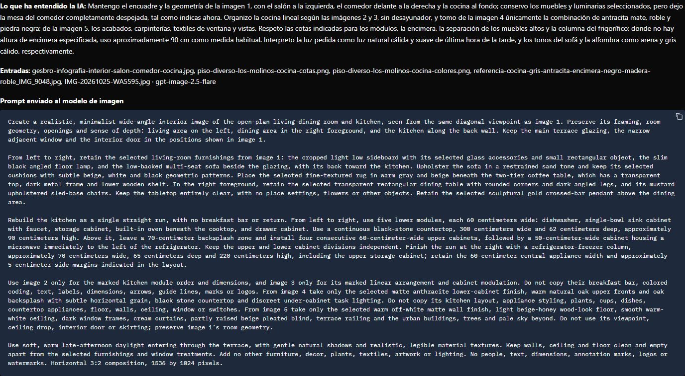

- **Lo que ha entendido la IA:** cómo ha interpretado tus referencias, notas e indicaciones, y las
  decisiones que ha tomado. Aquí, por ejemplo, que ha hecho la cocina «sin desayunador» y que, sin
  una altura de encimera escrita, usa «aproximadamente 90 cm como medida habitual».
- **Dudas:** si las hay, lo que conviene aclarar en las indicaciones de la siguiente generación.
- **Entradas:** las imágenes enviadas y el despliegue que generó la imagen.
- **Prompt enviado al modelo de imagen**, en inglés, tal cual.

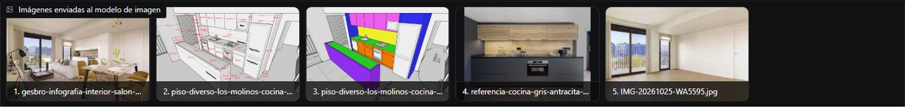

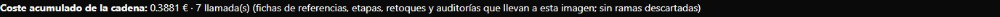

El **coste acumulado de la cadena** suma todo lo que ha costado llegar a esa imagen: las recetas de
las referencias que usó, el prompt y el lote que la generó (sin las ramas descartadas).
