# 3. Bocetos

Los bocetos son **exploraciones rápidas** del espacio a partir de las referencias activas: sirven
para decidir la composición general, los colores y los materiales antes de afinar. La pestaña se
desbloquea en cuanto hay alguna referencia activa.

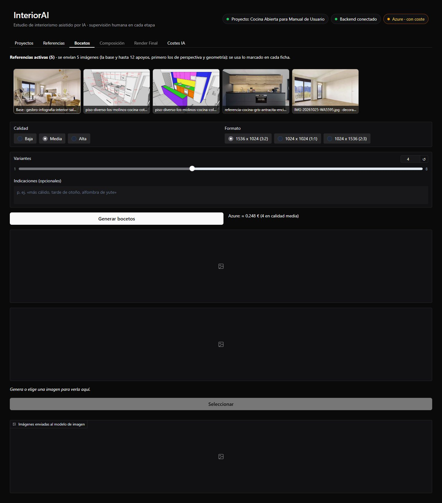

## Lo que recibe el modelo

Arriba se ven las **referencias activas** que se enviarán, en orden: primero la **imagen base**
(la que tiene la perspectiva marcada) y después los apoyos. Si hubiera más de las que caben, las
sobrantes aparecerían con el pie en rojo.

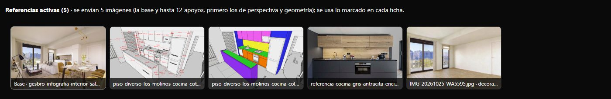

## Opciones

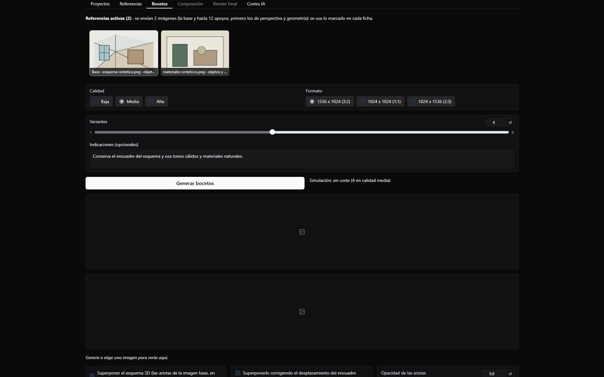

| Opción | Uso |
|--------|-----|
| **Calidad** | Baja, media o alta. Media es un buen equilibrio; alta tarda y cuesta más |
| **Formato** | Horizontal 3:2 (1536 × 1024), cuadrado o vertical |
| **Variantes** | De 1 a 8 imágenes por tanda (4 por defecto): todas con el mismo prompt, el modelo varía el resultado |
| **Indicaciones** | Lo que quieres en esta tanda, en texto libre (opcional). Al generar, el cuadro se vacía y lo escrito queda con cada imagen («Tus indicaciones», en su trazabilidad) |

Junto al botón se ve la **estimación del coste**, que cambia con las variantes y la calidad. En
modo Azure, si pasa de 0,20 €, el botón pide una **confirmación** en rojo antes de llamar a la IA:

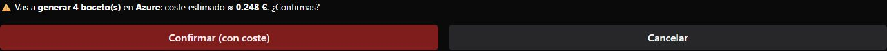

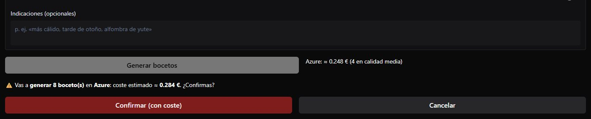

**Cancelar** no tiene coste. Mientras trabaja la IA, se ve «procesando» con el tiempo transcurrido
y el previsto:

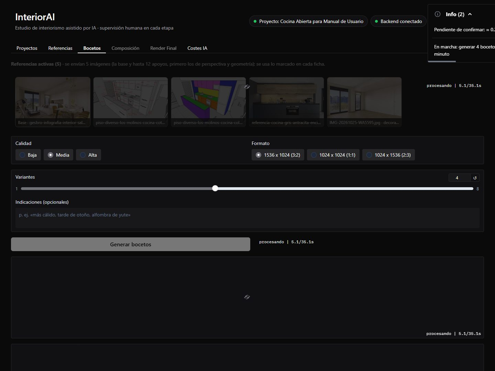

## Qué pasa al generar

1. El `PROMPT_ARCHITECT` escribe el prompt de esa tanda con todo lo anterior: la descripción del
   proyecto, el papel de cada imagen, lo marcado (y lo no marcado) de cada ficha y tus
   indicaciones.
2. El `FAST_DRAFT_MAKER` genera las variantes.
3. Aparecen en la galería, **sin seleccionar**: eliges tú.

En el caso se hicieron dos tandas de 4 en calidad media (unos 0,24 € cada una): la primera sin
indicaciones y la segunda con estas:

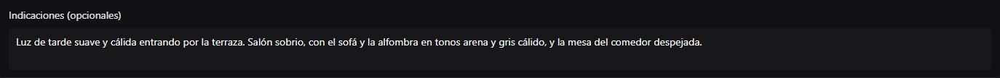

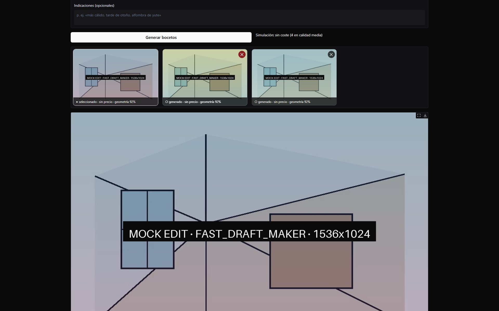

Esta captura de interfaz usa una tanda y referencias geométricas sintéticas en modo mock; las
imágenes generadas se identifican con la banda «MOCK». El caso de la guía tiene las dos tandas
descritas arriba.

## Elegir un boceto

Al hacer clic en una miniatura se ve en grande, en su proporción, con su línea de datos (estado,
tamaño, calidad, coste y fecha). **Seleccionar** la elige: es la que usará la composición. Solo
hay **una seleccionada por etapa**; al elegir otra, la anterior deja de estarlo.

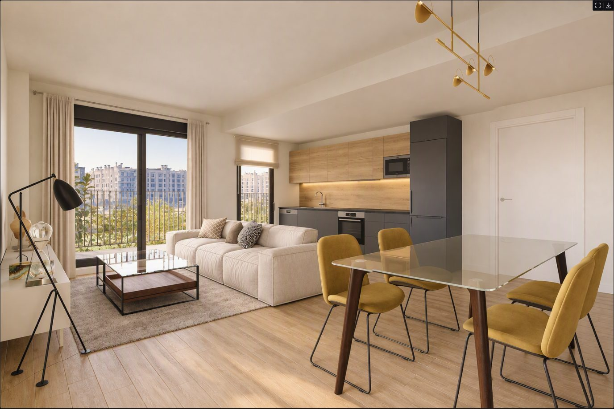

## Superponer el esquema 3D

Si la imagen base es un esquema 3D (por ejemplo, de SketchUp, con aristas negras), bajo la imagen
en grande tienes dos comparativas, con la opacidad que elijas:

- **Superponer el esquema 3D**: sus aristas, en rojo, tal cual sobre la imagen.
- **Superponerlo corrigiendo el desplazamiento del encuadre**: las mismas aristas movidas para
  que encajen lo mejor posible, útil cuando el modelo ha corrido la escena entera.

Las dos son **excluyentes**: al marcar una se desmarca la otra, así solo se ve una comparativa a
la vez. La medida de cada una aparece **debajo de su casilla** (el porcentaje y, en la ajustada,
también cuánto se ha movido el encuadre); la imagen no cambia ni lleva texto encima.

Cada imagen indica además su **fidelidad al esquema**: la parte de sus aristas que coincide a ±3
y ±8 px (en el pie de la miniatura, la de ±8 px), útil para elegir la más fiel de una tanda.
Funciona igual en Composición y Render final.

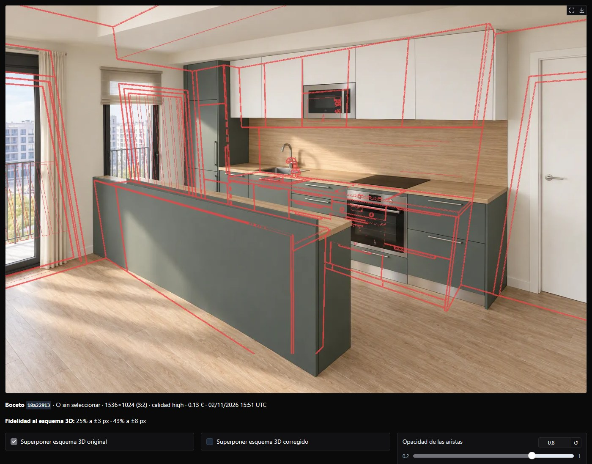

## Descartar y recuperar

Para que las candidatas que no te convencen no estorben, apártalas a **Descartados**. No se
borra nada: lo que costaron sigue en Costes IA y las puedes recuperar.

- El **aspa** de cada miniatura la descarta. La seleccionada no tiene aspa.
- **Descartar**, junto a **Seleccionar**, descarta la que se ve en grande. Con la seleccionada solo
  queda **Seleccionada ●**, apagado.

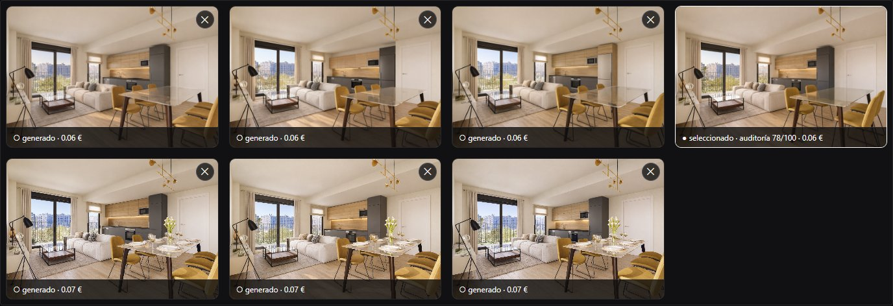

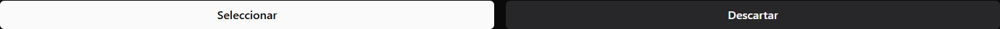

Las descartadas van al desplegable **Descartados (n)**, al final de la pestaña, cerrado; solo
aparece si hay alguna. Ahí no se abren en grande: su **✓** las devuelve a las candidatas, en su
sitio, y desde ahí se pueden ver y seleccionar.

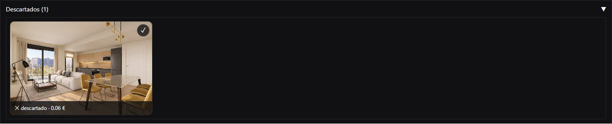

Una imagen descartada no se usa: no se puede seleccionar, retocar, auditar ni repetir con «Otra
versión» sin recuperarla antes, y la IA no la tiene en cuenta como generación anterior al
escribir los prompts. Composición y Render final funcionan igual.

## La trazabilidad de cada imagen

Debajo de la imagen está todo lo que la explica:

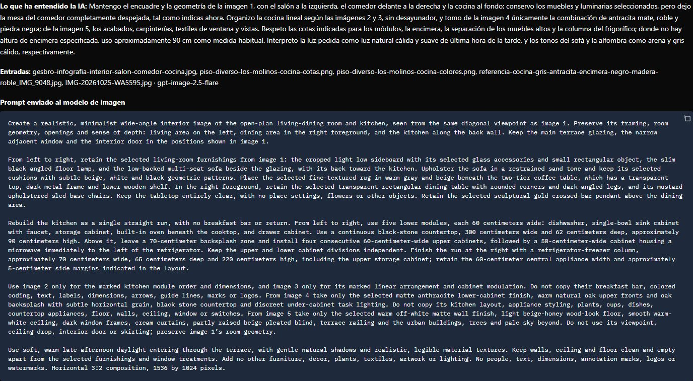

- **Tus indicaciones:** lo que escribiste para esa generación, tal cual.
- **Lo que ha entendido la IA:** cómo ha interpretado tus referencias, notas e indicaciones, y las
  decisiones que ha tomado. Aquí, por ejemplo, que ha hecho la cocina «sin desayunador» y que, sin
  una altura de encimera escrita, usa «aproximadamente 90 cm como medida habitual».
- **Dudas:** si las hay, lo que conviene aclarar en las indicaciones de la siguiente generación.
- **Entradas:** las imágenes enviadas y el despliegue que generó la imagen.
- **Prompt enviado al modelo de imagen**, en inglés, tal cual.

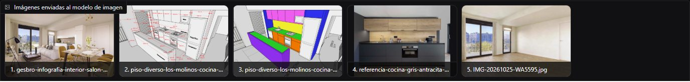

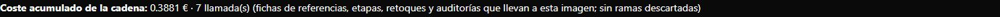

El **coste acumulado de la cadena** suma todo lo que ha costado llegar a esa imagen: las recetas de
las referencias que usó, el prompt y el lote que la generó (sin las ramas descartadas).
