# 4. Composición

La composición **materializa el boceto elegido con fidelidad**: corrige la geometría con las
referencias del espacio, ajusta el mobiliario y los materiales, y admite **retoques de una zona**.
La pestaña se desbloquea cuando hay un boceto seleccionado.

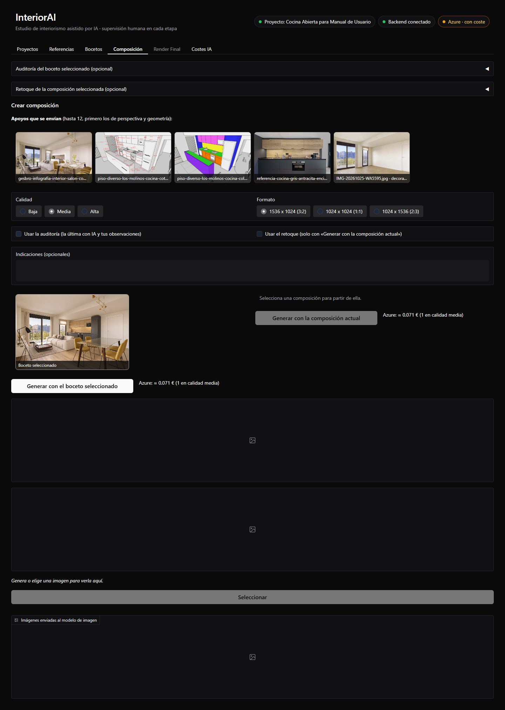

Tiene dos secciones opcionales plegables, **Auditoría** y **Retoque**, y la sección **Crear
composición**. La auditoría se abre sola si el boceto seleccionado ya tiene una.

## Auditoría del boceto (opcional)

El `GEOMETRY_AUDITOR` compara el boceto con **todas las referencias activas que marcan perspectiva
o geometría** y comprueba lo marcado en las fichas. Es opcional, y es la acción más cara (unos
0,15-0,25 €): úsala cuando el boceto no respete bien el espacio.

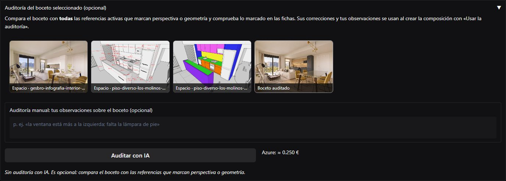

Arriba se ven las imágenes que se comparan. En **Auditoría manual** puedes escribir lo que has
visto tú o lo que quieres que compruebe. En el caso:

> Comprueba que la cocina siga la distribución del modelo 3D (cinco módulos bajos y la columna del
> frigorífico a la derecha) y que no aparezca ningún desayunador.

Al pulsar **Auditar con IA** se pide confirmación, por su coste:

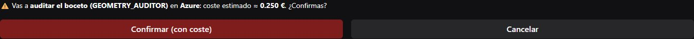

Al cabo de un minuto, más o menos, llega el informe:

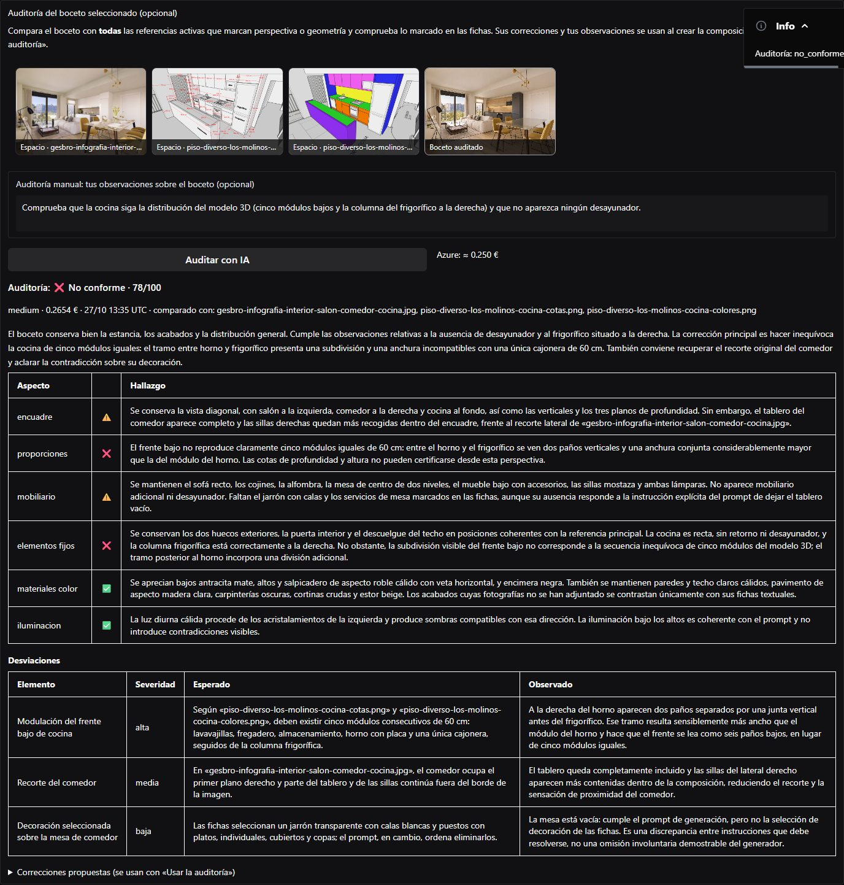

- **Veredicto y puntuación** (aquí, «No conforme · 78/100»), con su coste y las referencias
  comparadas.
- **Resumen**, **comprobaciones** por aspecto (encuadre, proporciones, mobiliario, elementos fijos,
  materiales y color, iluminación) y **desviaciones** con su severidad.
- **Correcciones propuestas**, en inglés, listas para la composición.

En el caso confirmó que no hay desayunador y que el frigorífico está a la derecha, pero detectó
que el tramo entre el horno y el frigorífico no cuadraba con cinco módulos de 60 cm.

## Crear la composición

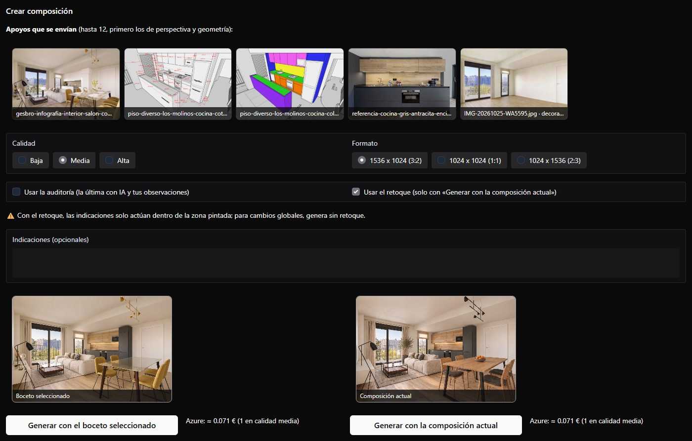

| Parte | Uso |
|-------|-----|
| **Apoyos que se envían** | Las referencias activas que recibirá el modelo junto a la imagen de partida (hasta 12) |
| **Calidad** y **Formato** | Como en los bocetos |
| **Usar la auditoría** | Añade al prompt las correcciones de la última auditoría con IA y tus observaciones |
| **Usar el retoque** | Aplica el retoque de la sección **Retoque** (ver abajo); solo con **Generar con la composición actual** |
| **Indicaciones** | Cambios que quieres en esta composición |
| **Generar con el boceto seleccionado** | Parte del boceto elegido |
| **Generar con la composición actual** | Parte de la composición seleccionada, para seguir mejorándola |

En el caso, la primera composición se generó **con el boceto seleccionado** y **usando la
auditoría**, con estas indicaciones para que el salón y el comedor combinen con la cocina:

> Cambia las sillas mostaza del comedor por sillas de madera de roble con asiento tapizado en gris
> antracita, y la mesa de vidrio por una mesa de roble con patas metálicas negras mate. Sofá en
> tejido gris cálido claro, alfombra de lana en tonos arena y las dos lámparas (la de pie y la del
> comedor) en negro mate en lugar de dorado. Quita los objetos del mueble bajo del salón.

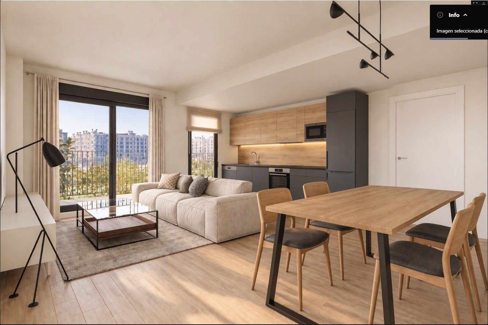

La cocina corrige lo que señaló la auditoría y el mobiliario cambia de color y material como se
pidió. Su trazabilidad lo explica:

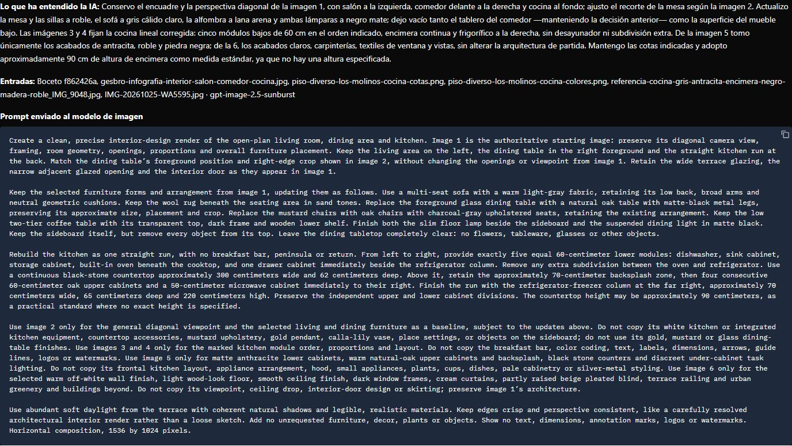

## Retoque con máscara

El retoque cambia **solo una zona** de la composición seleccionada: la pintas y describes el
cambio. El resto de la imagen se conserva. Es la herramienta para añadir, quitar o cambiar un
elemento concreto.

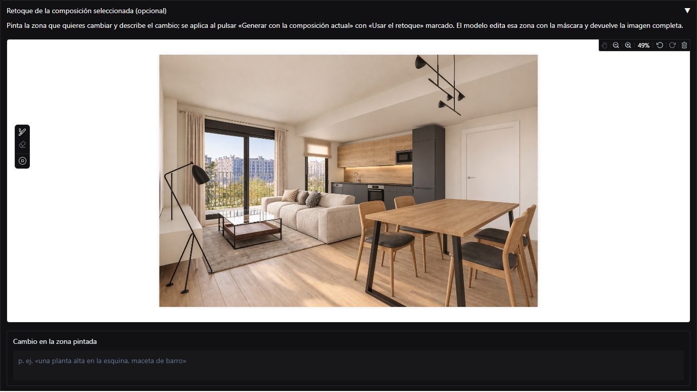

### El editor

| Herramienta | Uso |
|-------------|-----|
| **Pincel** | Pinta en rojo la zona que se va a cambiar |
| **Goma** | Borra parte de lo pintado |
| **Tamaño** (circunferencias) | Grosor del pincel o de la goma |
| **Acercar** y **Alejar** | Zoom de la imagen; la rueda del ratón desplaza la página |
| **Mano** | Mueve la imagen ampliada (solo con zoom) |
| **Deshacer**, **Rehacer**, **Borrar todo** | Sobre los trazos |

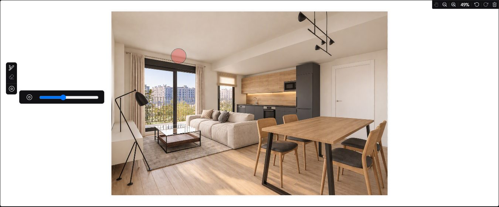

Pinta **con margen**: lo nuevo debe caber dentro de la zona. En el caso se pintó junto al ventanal
de la terraza, detrás del extremo del sofá:

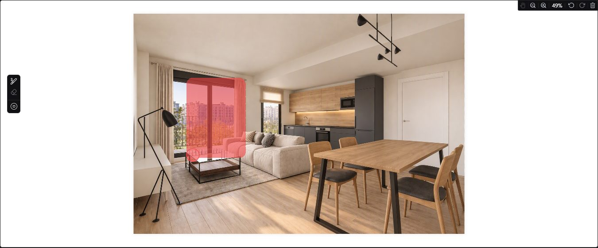

En **Cambio en la zona pintada** se describe el cambio:

> Una planta de interior grande, un olivo de 1,5 m de alto, en una maceta cilíndrica de cerámica
> gris antracita mate, apoyada en el suelo entre los dos ventanales, detrás del extremo del sofá.

Después se marca **Usar el retoque** y se pulsa **Generar con la composición actual**:

!!! warning "Indicaciones con el retoque"
    Con el retoque, las indicaciones **solo actúan dentro de la zona pintada**. Para cambios en el
    resto de la imagen, genera sin retoque.

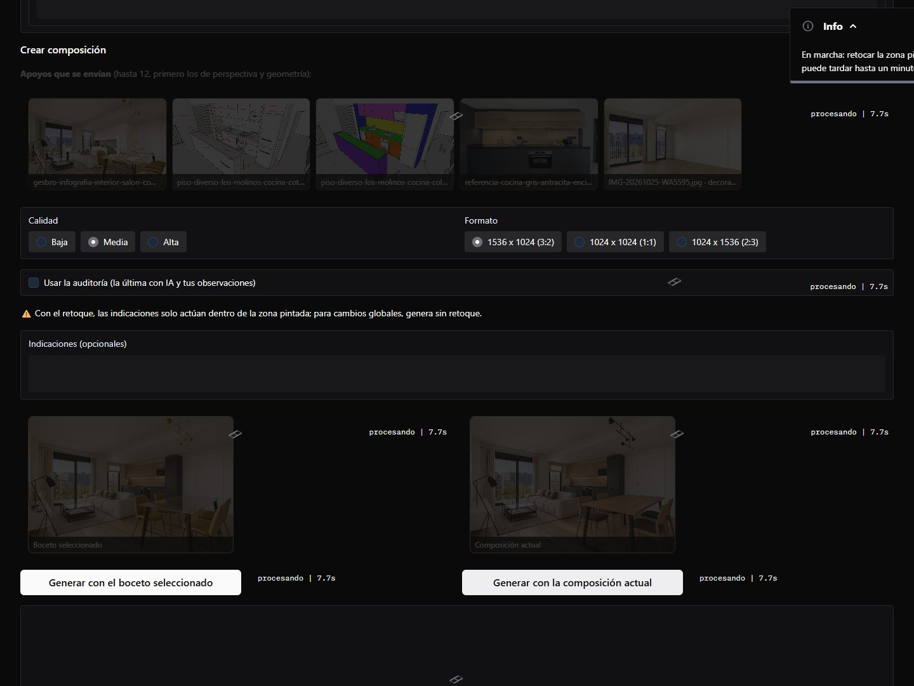

El `COMPOSITION_BUILDER` edita la zona con la máscara y devuelve la imagen completa, como una
composición nueva marcada como «retoque»:

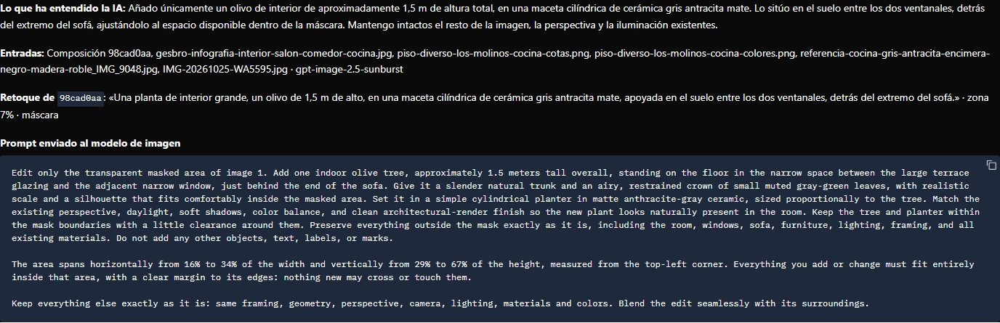

Entre las imágenes enviadas al modelo aparece la **máscara** (blanco: zona retocada):

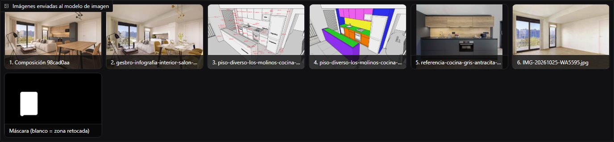

## Seguir mejorando: con la composición actual

Con el retoque seleccionado se generó otra composición **con la composición actual**, sin retoque,
con una indicación pequeña: «Añade sobre la mesa del comedor un único cuenco bajo de cerámica gris
mate con unas pocas naranjas. No cambies nada más.» Se conservó todo, incluido el olivo del
retoque, porque la IA conoce el **historial** de la imagen de partida:

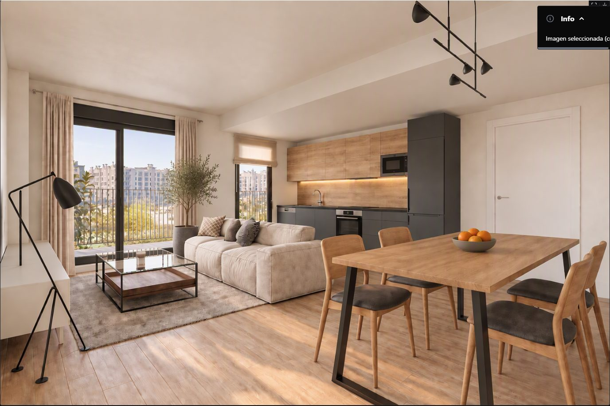

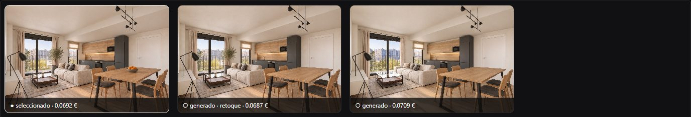

Esta es la composición seleccionada para el render final. Su cadena (recetas, boceto, auditoría,
composiciones y retoque) costó:

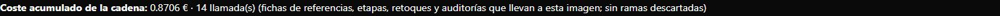
