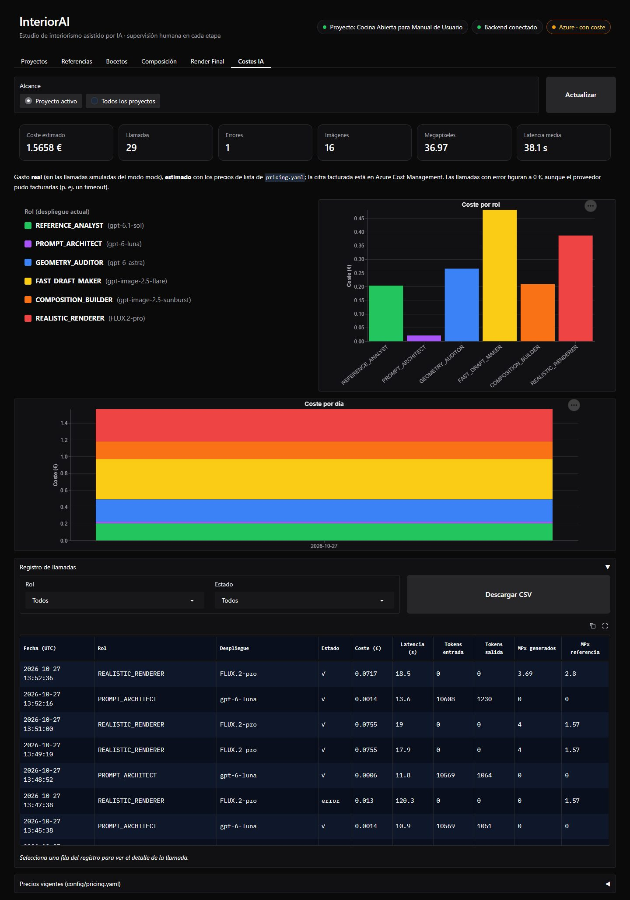
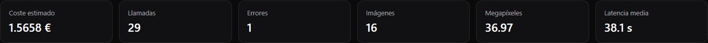
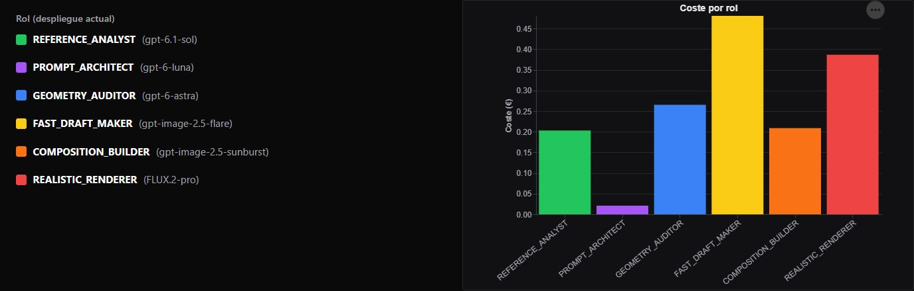
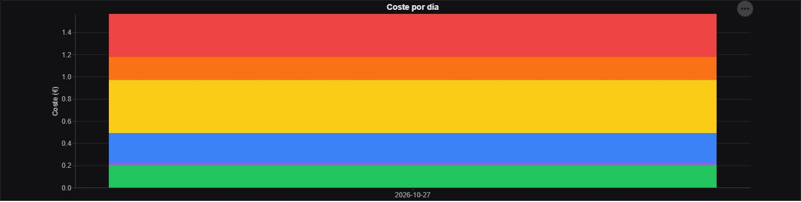
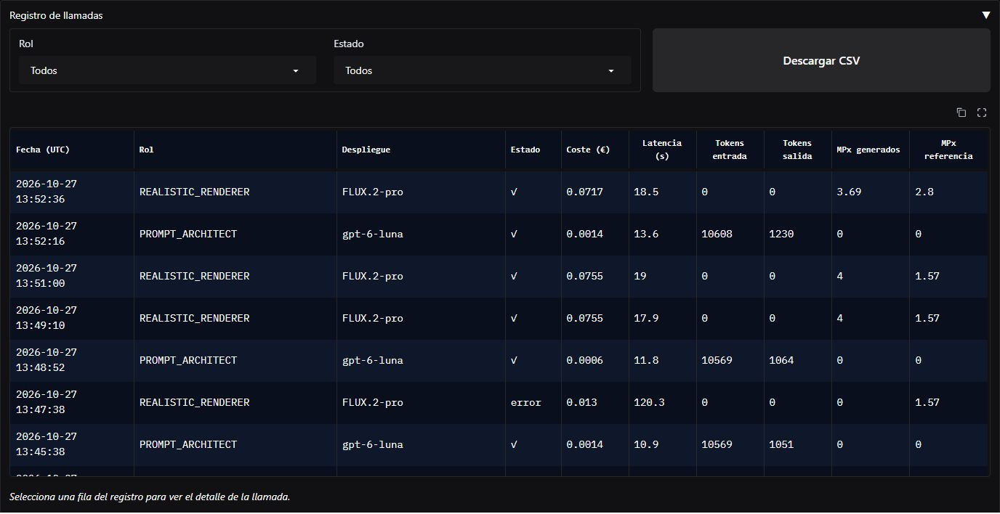
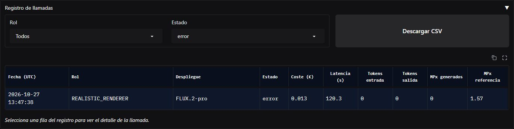
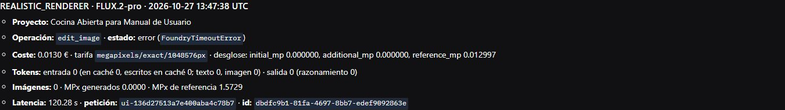
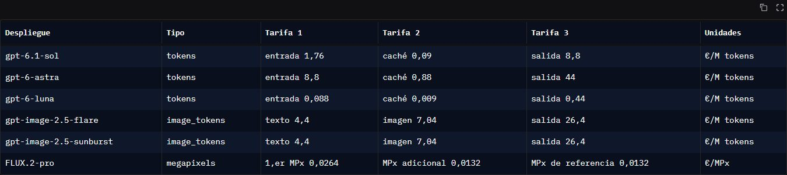
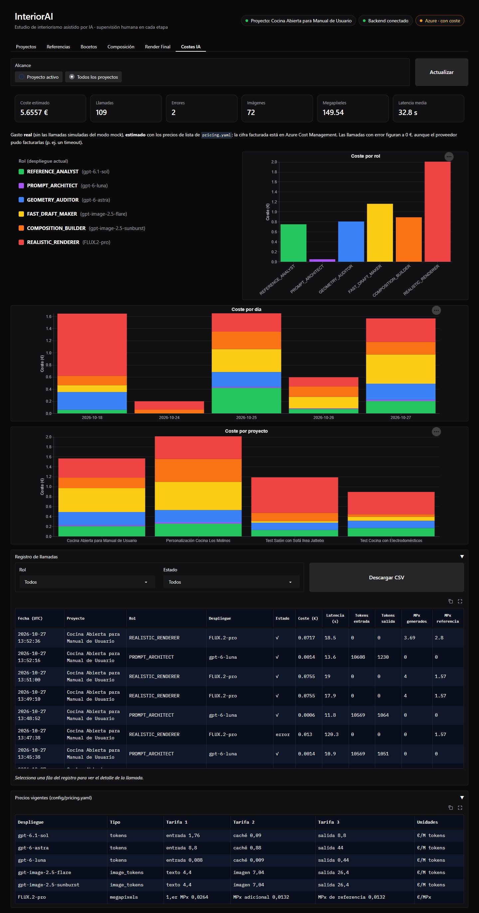
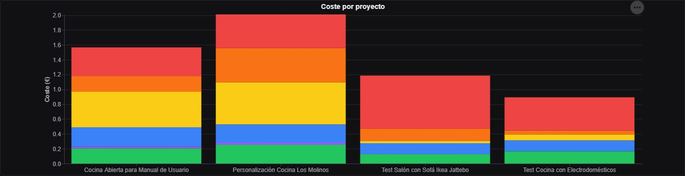

# 6. Costes IA

Cada llamada a la IA queda registrada con su coste **estimado** con los precios de lista. Esta
pestaña lo resume, para el proyecto activo o para todos.

!!! info "Estimado, no facturado"
    El gasto es **real** (no incluye las llamadas simuladas del modo mock), pero **estimado** con
    los precios de `config/pricing.yaml`. La cifra facturada está en Azure Cost Management.

## Alcance e indicadores

**Alcance** elige entre el **proyecto activo** y **todos los proyectos**; **Actualizar** vuelve a
leer el registro.

| Indicador | Qué cuenta |
|-----------|-----------|
| **Coste estimado** | La suma de las llamadas, en euros |
| **Llamadas** | Todas las llamadas a la IA, también las que terminaron en error |
| **Errores** | Las llamadas que fallaron |
| **Imágenes** | Las imágenes generadas |
| **Megapíxeles** | El tamaño total de las imágenes generadas |
| **Latencia media** | Lo que tarda de media una llamada |

En el caso: **1,5658 €** en 29 llamadas, con 1 error y 16 imágenes.

## Gráficos

Cada rol tiene su color, el mismo en todos los gráficos; la leyenda indica el despliegue actual de
cada rol.

- **Coste por rol:** en el caso, lo más caro fueron los bocetos (`FAST_DRAFT_MAKER`) y los renders
  (`REALISTIC_RENDERER`); el `PROMPT_ARCHITECT` apenas cuesta.
- **Coste por día:** el gasto de cada día, apilado por rol.
- **Coste por proyecto** (solo con **Todos los proyectos**): el gasto de cada proyecto, apilado por
  rol.

Al pasar el ratón por una barra se ven su coste exacto y su número de llamadas.

## Registro de llamadas

Una fila por llamada, de la más reciente a la más antigua: fecha, rol, despliegue, estado, coste,
latencia, tokens de entrada y salida y megapíxeles generados y de referencia. Los filtros **Rol**
y **Estado** acotan la tabla; **Descargar CSV** descarga lo filtrado, con todas las columnas
(también las que la tabla no muestra).

Con el filtro **Estado: error** aparece el intento del render de noche que agotó el tiempo:

Al seleccionar una fila se ve el **detalle de la llamada**: operación y error, el desglose del
coste según la tarifa, los tokens (también los de caché y razonamiento), las imágenes, la latencia
y los identificadores de la petición.

!!! warning "Las llamadas con error también pueden costar"
    Un tiempo agotado pudo facturarse aunque no devuelva nada. Aquí el registro le asigna lo que
    se conoce, las imágenes de referencia enviadas (0,013 €). Por eso la aplicación **nunca
    reintenta un tiempo agotado** por su cuenta.

## Precios vigentes

**Precios vigentes** muestra las tarifas de cada despliegue que se usan en la estimación: por
millón de tokens (de texto, de imagen, en caché y de salida) o por megapíxel.

## Todos los proyectos

Con **Todos los proyectos**, los indicadores y los gráficos suman todos los proyectos, aparece el
gráfico **Coste por proyecto** y el registro añade la columna **Proyecto**:

