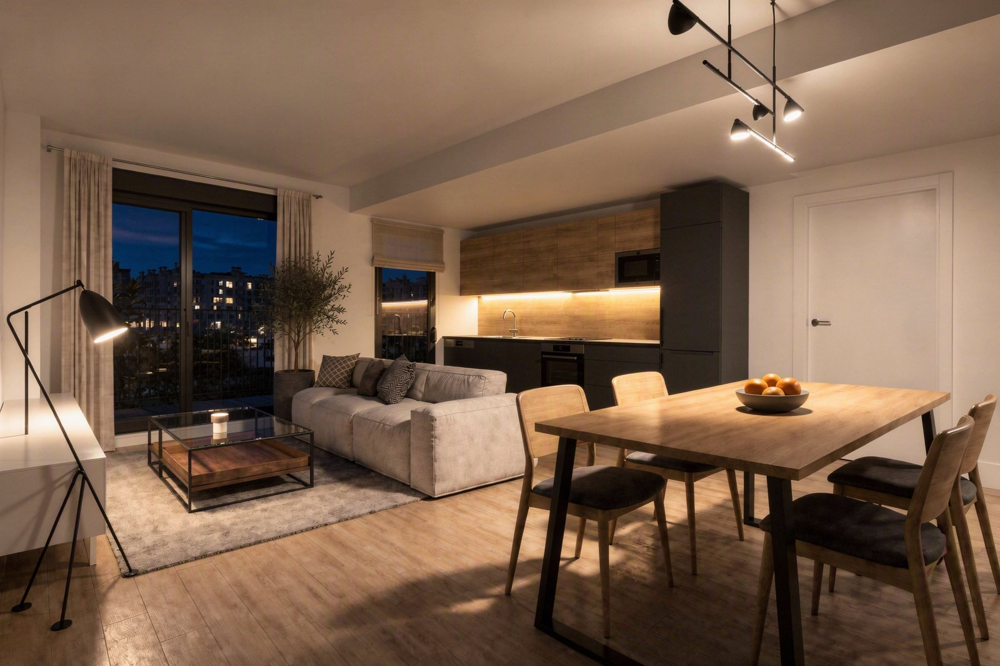
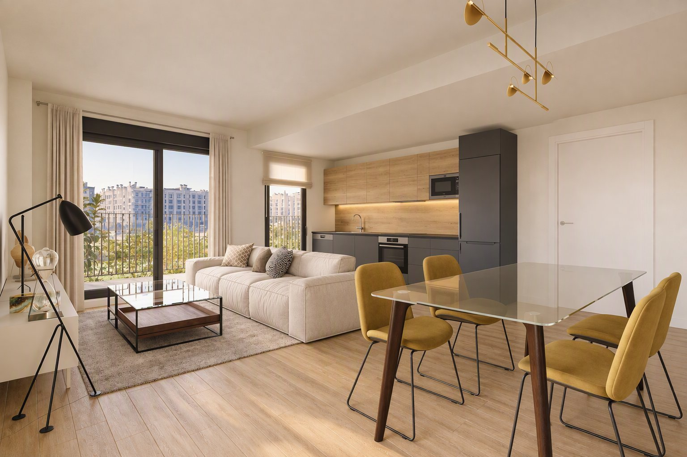
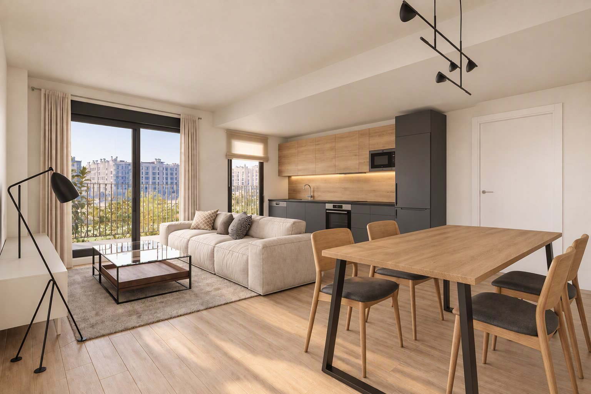
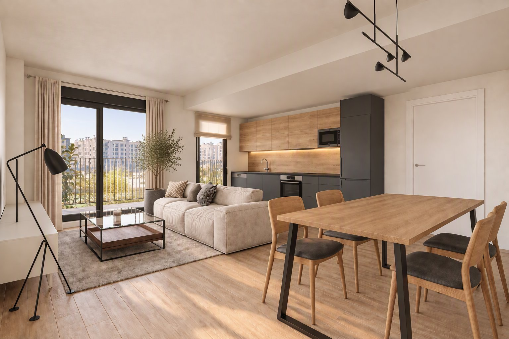
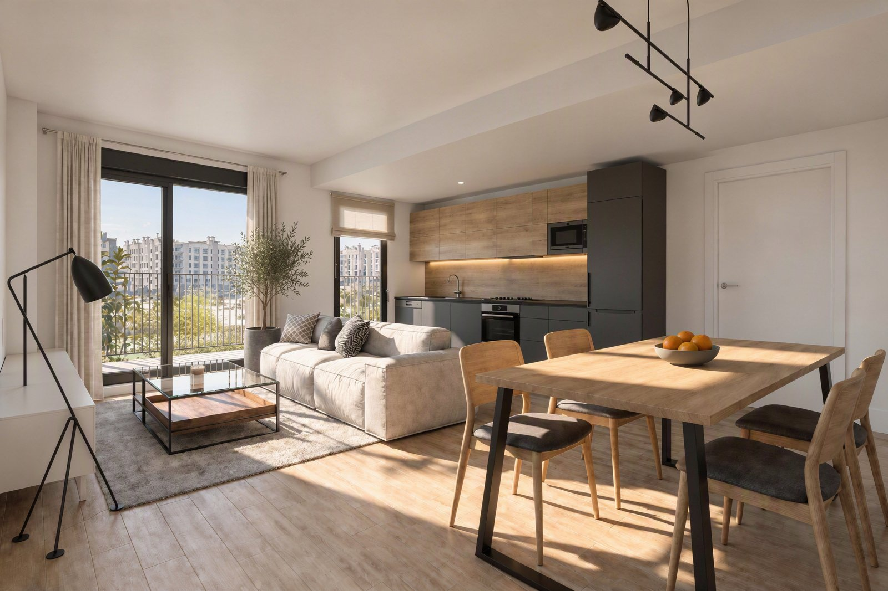

# Manual de usuario

Este manual recorre **todas las pestañas y opciones** de InteriorAI con un caso real, hecho desde
cero en la aplicación con la IA de Azure: **«Cocina Abierta para Manual de Usuario»**, una cocina
abierta al salón-comedor de un piso de obra nueva.

## El caso en cuatro imágenes

<figure markdown="span">
  
  <figcaption>1. Boceto elegido: la vista del salón con la cocina antracita y roble</figcaption>
</figure>

<figure markdown="span">
  
  <figcaption>2. Composición: muebles que combinan con la cocina</figcaption>
</figure>

<figure markdown="span">
  
  <figcaption>3. Retoque: un olivo en maceta pintando solo su zona</figcaption>
</figure>

<figure markdown="span">
  
  <figcaption>4. Render final: la fotografía realista (aquí, de día)</figcaption>
</figure>

## Qué se pidió

El objetivo era ver la cocina terminada desde el punto de vista general del salón, con:

- **la perspectiva y el mobiliario** de una infografía comercial del salón-comedor;
- **las medidas y la distribución** del frente de la cocina de un modelo 3D de SketchUp, sin el
  desayunador que aparece en el modelo;
- **los colores y materiales** de una cocina real de referencia: gris antracita, roble y piedra
  negra;
- **los materiales del espacio** (paredes, suelo, techo, ventanas, cortina, estor, vistas y
  barandilla) de una fotografía del piso vacío;
- en la composición, cambiar los muebles del salón y el comedor para que combinen con la cocina
  y, con un retoque, **añadir una planta en maceta**;
- un render final **de día**, otro **al atardecer** y otro **de noche**, que es el elegido.

## Recorrido

| Paso | Pestaña | Qué se hace |
|------|---------|-------------|
| 1 | [Proyectos](proyectos.md) | Crear el proyecto y describir la intención del diseño |
| 2 | [Referencias](referencias.md) | Subir las 6 imágenes con notas, revisar sus fichas y marcar lo que se usa |
| 3 | [Bocetos](bocetos.md) | Dos tandas de 4 bocetos (la segunda con indicaciones) y elegir uno |
| 4 | [Composición](composicion.md) | Auditoría del boceto, composición con cambios de mobiliario y retoque con máscara |
| 5 | [Render final](render-final.md) | Día, atardecer y noche; otra versión y una panorámica |
| 6 | [Costes IA](costes.md) | Revisar lo que ha costado y el detalle de cada llamada |
| | [Consejos](consejos.md) | Cómo escribir notas e indicaciones y qué marcar en las fichas |

## Lo que costó

El caso se estimó en **1,57 €** en 29 llamadas a la IA; Azure facturó unos **1,40 €**. La
estimación usa los precios de lista y redondea al céntimo hacia arriba, así que la factura queda
siempre por debajo:

| Rol | Llamadas | Coste estimado | Para qué |
|-----|----------|----------------|----------|
| `REFERENCE_ANALYST` | 7 | 0,21 € | Las recetas de las 6 referencias y un nuevo análisis |
| `PROMPT_ARCHITECT` | 10 | 0,03 € | Un prompt por cada generación |
| `FAST_DRAFT_MAKER` | 2 | 0,49 € | Dos tandas de 4 bocetos |
| `GEOMETRY_AUDITOR` | 1 | 0,27 € | La auditoría del boceto |
| `COMPOSITION_BUILDER` | 3 | 0,21 € | Composición, retoque y otra composición |
| `REALISTIC_RENDERER` | 6 | 0,39 € | Cinco renders finales y un intento que agotó el tiempo |

!!! tip "Antes de empezar"
    Si aún no tienes la aplicación en marcha, sigue [Instalación](../primeros-pasos/instalacion.md).
    Puedes recorrer el manual en **modo simulación**, sin coste: las imágenes serán marcos de
    colores, pero todas las pantallas y opciones son las mismas.
