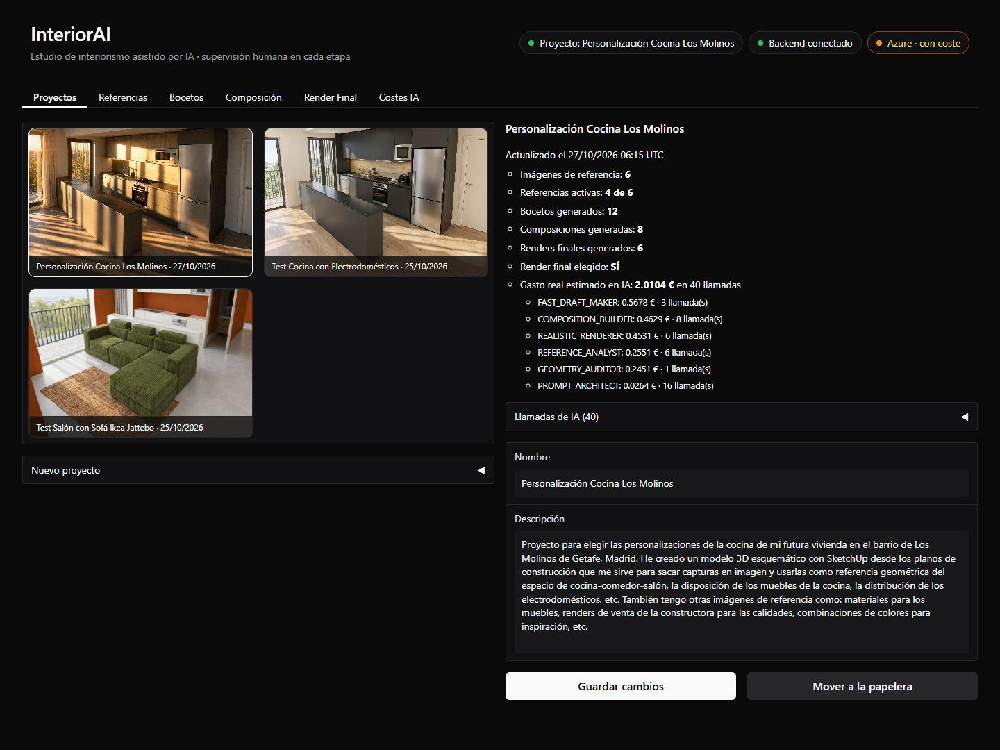
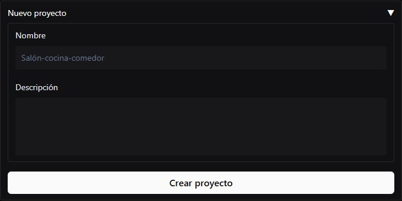
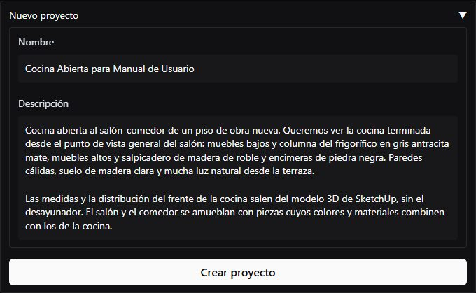
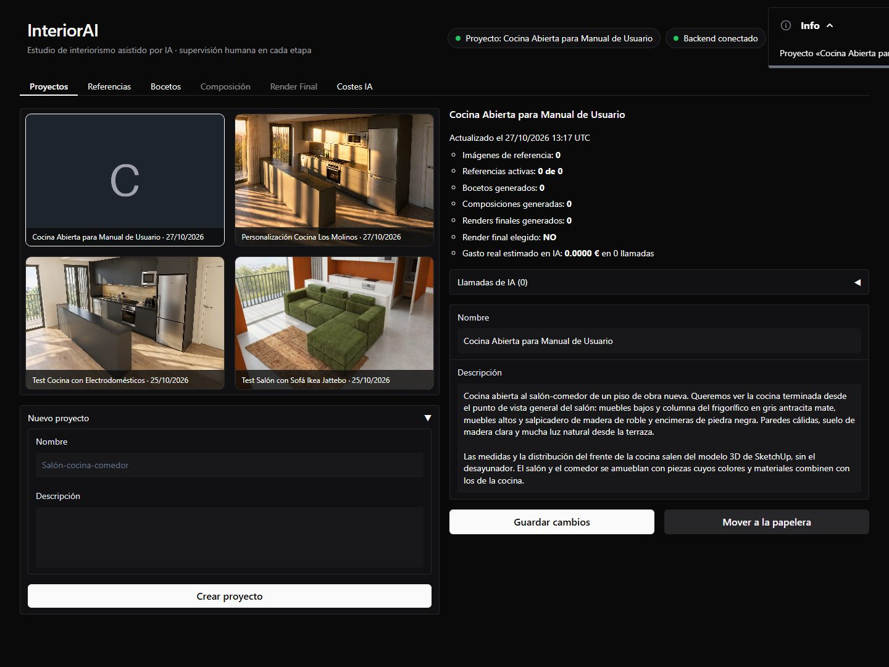
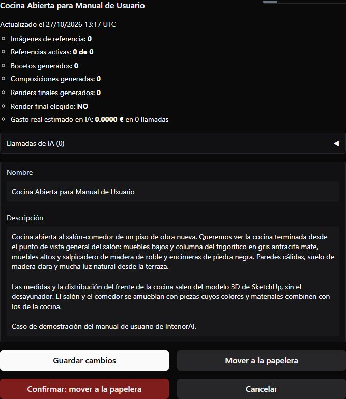
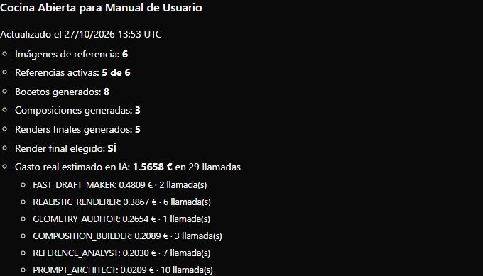
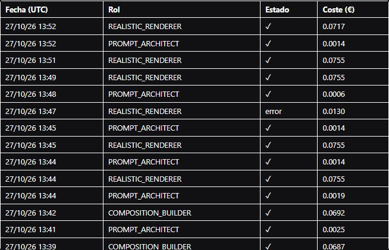
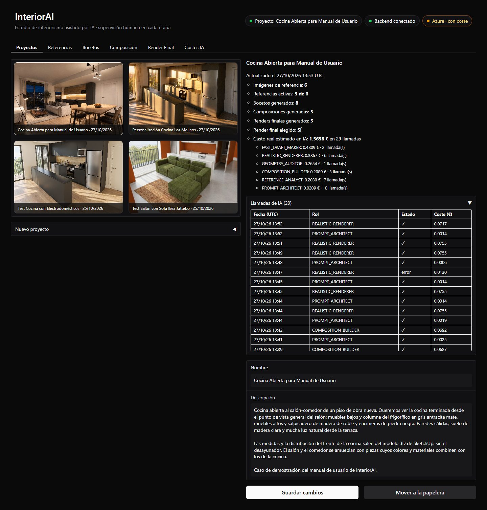

# 1. Proyectos

Un proyecto es **un espacio de la casa**: una cocina, un salón, un dormitorio… Todo lo demás
(referencias, bocetos, composiciones, renders y costes) cuelga de él.

La pestaña tiene dos columnas:

- **A la izquierda**, la galería de proyectos. Cada uno muestra como portada su imagen más
  avanzada (el render final elegido, si lo hay) y la fecha de su último cambio. Al hacer clic en
  uno, pasa a ser el **proyecto activo** (la cabecera lo indica) y el resto de pestañas trabajan
  con él. La aplicación lo recuerda en tu navegador.
- **A la derecha**, el resumen del proyecto activo y sus datos.

## Crear un proyecto

Despliega **Nuevo proyecto**, bajo la galería:

- **Nombre:** cómo lo reconocerás en la galería.
- **Descripción:** la intención del diseño, con tus palabras. **Es importante:** la IA la lee en
  cada generación como contexto del proyecto. Cuenta qué espacio es, qué quieres conseguir, los
  materiales y colores que tienes claros y lo que no quieres.

En el caso del manual:

> Cocina abierta al salón-comedor de un piso de obra nueva. Queremos ver la cocina terminada desde
> el punto de vista general del salón: muebles bajos y columna del frigorífico en gris antracita
> mate, muebles altos y salpicadero de madera de roble y encimeras de piedra negra. Paredes
> cálidas, suelo de madera clara y mucha luz natural desde la terraza.
>
> Las medidas y la distribución del frente de la cocina salen del modelo 3D de SketchUp, sin el
> desayunador. El salón y el comedor se amueblan con piezas cuyos colores y materiales combinen
> con los de la cocina.

Pulsa **Crear proyecto**: aparece en la galería y queda activo.

## Editar y mover a la papelera

Bajo el resumen puedes cambiar el **nombre** y la **descripción**; no se guardan hasta pulsar
**Guardar cambios**.

**Mover a la papelera** pide una confirmación antes de hacer nada:

{ width="480" }

El borrado es suave: el proyecto pasa a `data/.papelera/` y se puede restaurar
([Instalación › Comandos útiles](../primeros-pasos/instalacion.md#comandos-utiles)).

## El resumen

El resumen cuenta las referencias (y cuántas están activas), las imágenes generadas en cada
etapa, si hay un render final elegido y el **gasto real estimado** del proyecto, por rol. Debajo,
**Llamadas de IA** despliega las llamadas del proyecto, de la más reciente a la más antigua.

Así queda la pestaña al terminar el caso, con el render de noche como portada:

