# 2. Referencias

Las referencias son **todas las imágenes de las que parte el diseño**: vistas o capturas del
espacio, modelos 3D de SketchUp, planos, fotos de muebles, de materiales o de ambientes que te
inspiran. La IA analiza cada una y tú decides qué se usa de ella.

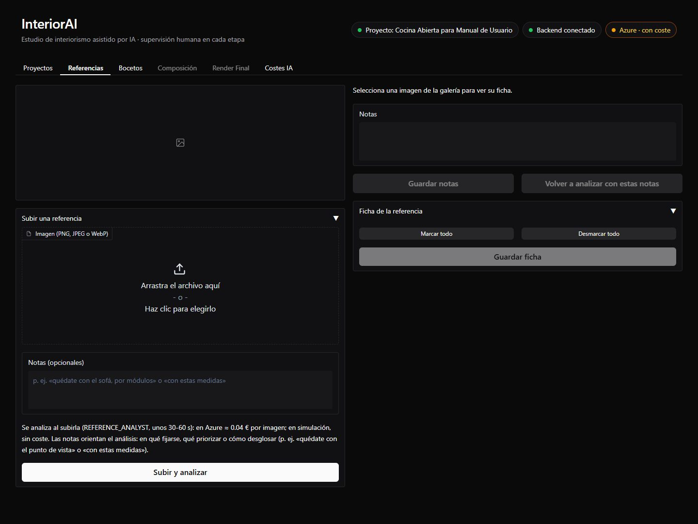

## Subir una referencia con notas

En **Subir una referencia** eliges la imagen (PNG, JPEG o WebP) y escribes **notas**: qué quieres
de esa imagen. Las notas orientan el análisis: en qué fijarse, qué priorizar y qué ignorar.

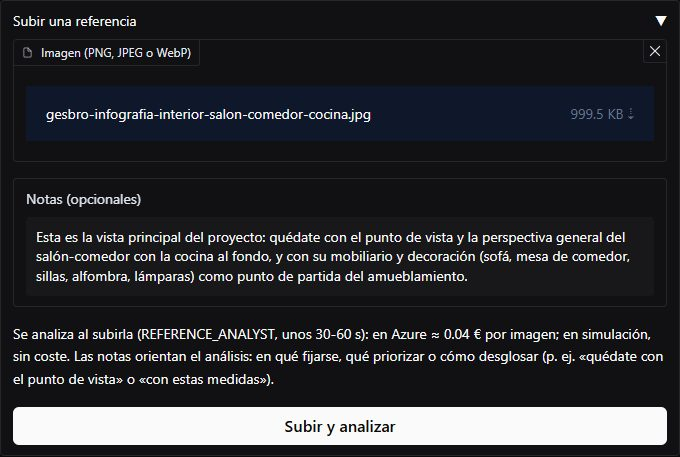{ width="560" }

Al pulsar **Subir y analizar**, el `REFERENCE_ANALYST` analiza la imagen (de 30 a 60 segundos;
unos 0,03-0,05 €) y la referencia aparece en la galería:

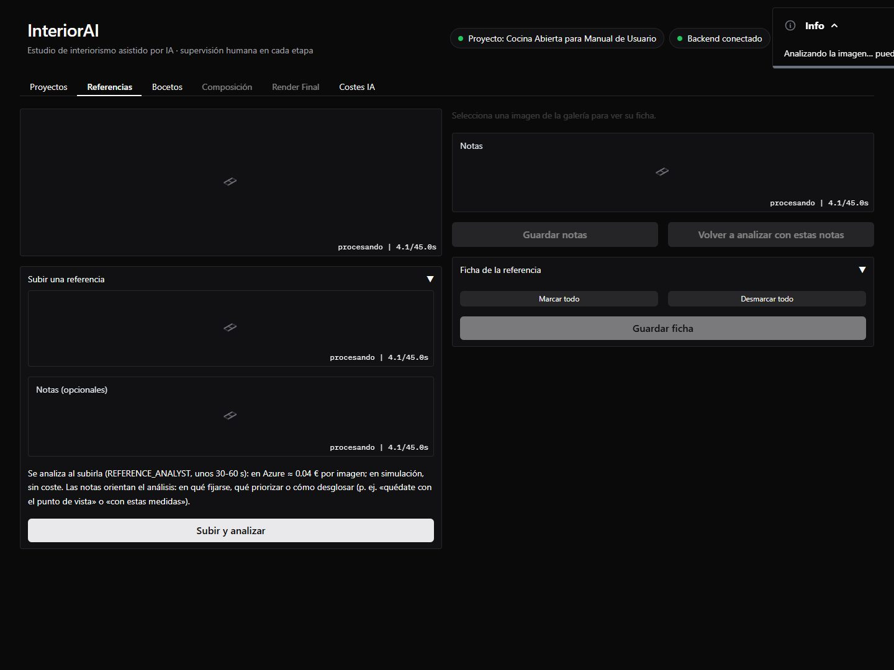

### Las 6 referencias del caso y sus notas

| Imagen | Notas |
|--------|-------|
| Infografía del salón-comedor con muebles | «Esta es la vista principal del proyecto: quédate con el punto de vista y la perspectiva general del salón-comedor con la cocina al fondo, y con su mobiliario y decoración (sofá, mesa de comedor, sillas, alfombra, lámparas) como punto de partida del amueblamiento.» |
| Modelo 3D de SketchUp con cotas | «Modelo 3D esquemático de SketchUp: quédate solo con las medidas y la distribución de los muebles y electrodomésticos del frente de la cocina. Ignora por completo el desayunador que está delante del cuerpo principal. No uses su punto de vista ni sus colores.» |
| El mismo modelo, coloreado por tipo de mueble | «Quédate solo con la distribución y la modulación de los muebles del frente de la cocina. Ignora el desayunador que está delante del cuerpo principal y los colores de marcado.» |
| Cocina real (vista frontal) | «Quédate con los colores y materiales: muebles bajos gris antracita mate, muebles altos y salpicadero de madera de roble y encimera de piedra negra. No uses su distribución.» |
| Cocina real (otro ángulo) | «Otra foto de la misma cocina de referencia, desde otro ángulo.» |
| Foto del piso vacío | «Quédate con los materiales de paredes, suelo y techo, las carpinterías de las ventanas, la cortina y el estor, las vistas exteriores y la barandilla de la terraza. No uses su punto de vista.» |

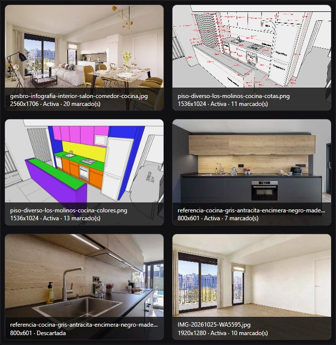

Cada miniatura indica el tamaño de la imagen, si está **activa** o **descartada** y cuántos
elementos tiene marcados.

## La receta y la ficha

Al seleccionar una referencia se ve a la derecha, en su proporción, con sus notas y su **ficha**:

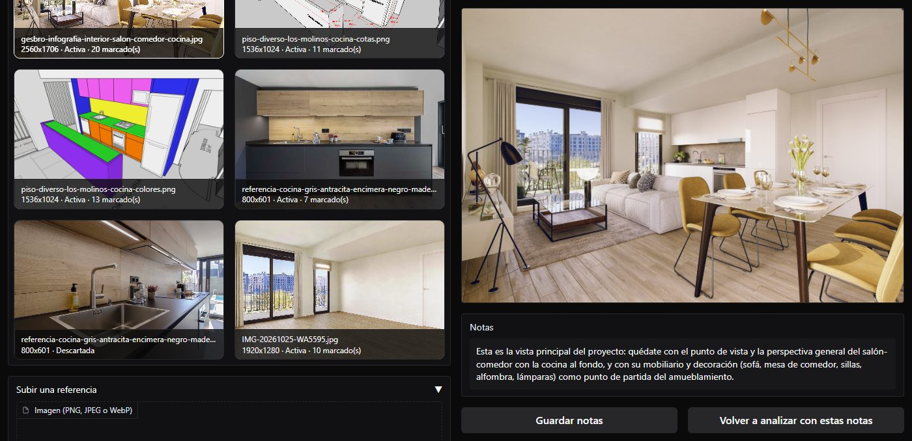

El análisis produce una **receta**: un resumen de qué es la imagen y lo que aporta, y todo lo útil
que contiene, ordenado en **12 grupos** (objetos y mobiliario; decoración; colores; materiales;
elementos arquitectónicos; estilo; iluminación; perspectiva y punto de vista; medidas y geometría;
ambiente; fotografía; otros). Cada elemento puede llevar sus **medidas** y su origen: escritas en
tus notas, leídas de una cota de la imagen o **estimadas** (siempre aproximadas).

La **ficha** es la receta con casillas: **solo cuenta lo marcado**. El análisis ya deja marcado lo
que piden tus notas; tú lo revisas.

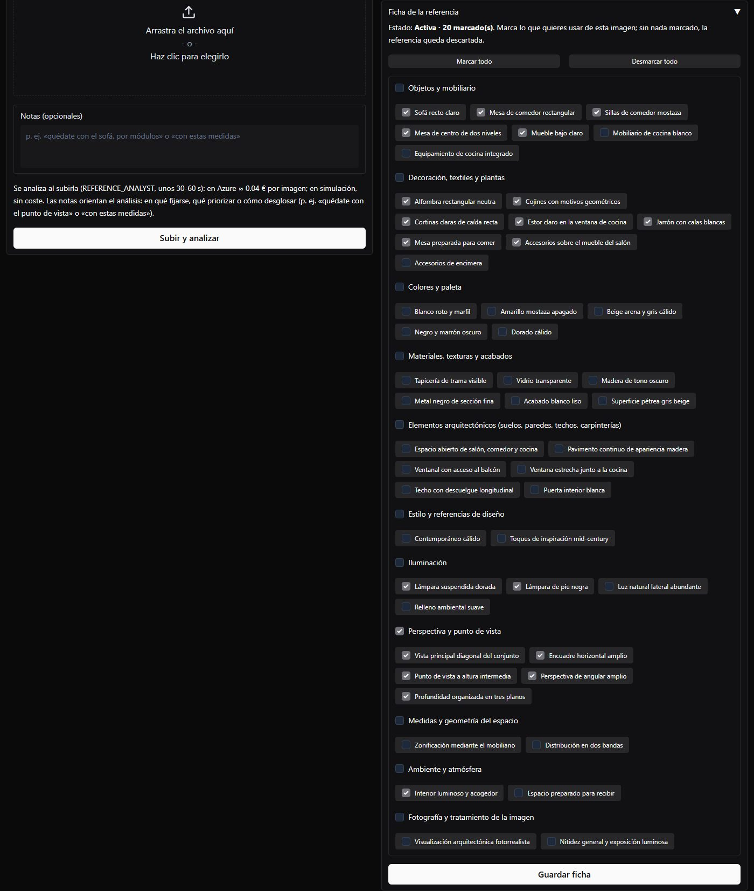

- Marca o desmarca **elementos sueltos**, o un **grupo entero** con su casilla.
- **Marcar todo** y **Desmarcar todo** cambian el formulario de golpe.
- Pasa el ratón por un elemento para ver su detalle y sus medidas.
- Los cambios **no se guardan hasta pulsar «Guardar ficha»**.

En el caso, en la infografía se desmarcaron la cocina blanca, su equipamiento y los accesorios de
la encimera (la cocina será antracita y roble), y se marcó el ambiente «interior luminoso y
acogedor»:

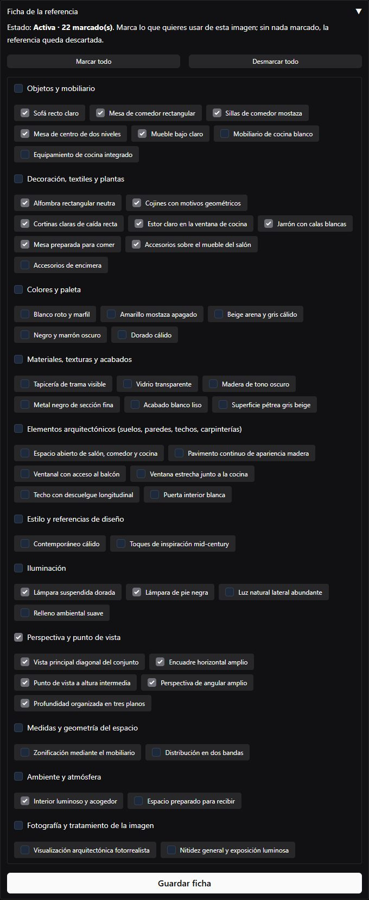{ width="560" }

??? example "Las fichas de las demás referencias del caso"

    === "Modelo 3D con cotas"

        Solo módulos, encimera, columna del frigorífico y distribución. El análisis ni siquiera
        incluyó el desayunador, como pedían las notas.

        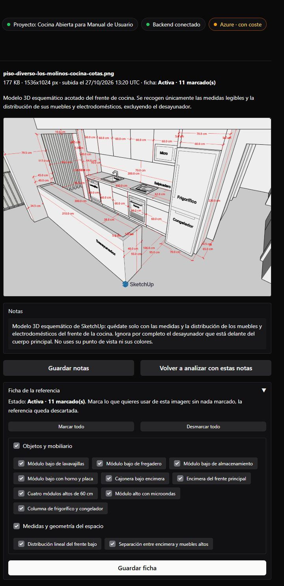

    === "Cocina real"

        Colores y materiales; además se marcó la luz bajo los muebles altos, útil para el render
        de noche.

        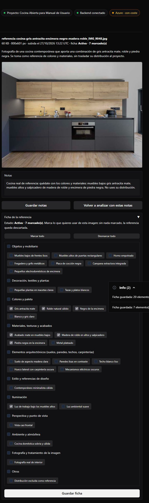

    === "Piso vacío"

        Paredes, suelo, techo, carpinterías, cortina, estor, barandilla y vistas.

        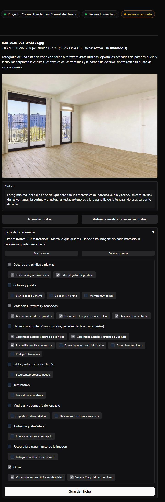

### Qué papel tiene cada referencia

- **La imagen base de los bocetos** es la primera referencia activa con algo marcado en
  **«Perspectiva y punto de vista»**: se dibuja sobre ella. En el caso, solo la infografía tiene la
  perspectiva marcada, así que todos los bocetos parten de su vista.
- **Las demás activas van como apoyo** (hasta 12, primero las que marcan perspectiva o geometría):
  el modelo de imagen las ve, pero solo toma lo marcado. Lo **no** marcado de cada una se le
  indica expresamente para que no lo copie.

## Activa o descartada

Una referencia **sin nada marcado está descartada**: se conserva, pero no se usa. En el caso, la
segunda foto de la cocina quedó descartada (sus notas no pedían nada):

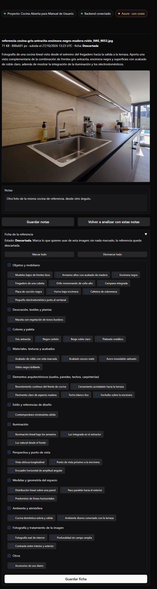{ width="560" }

**Marcar todo** marca todos sus elementos en el formulario (sin guardar):

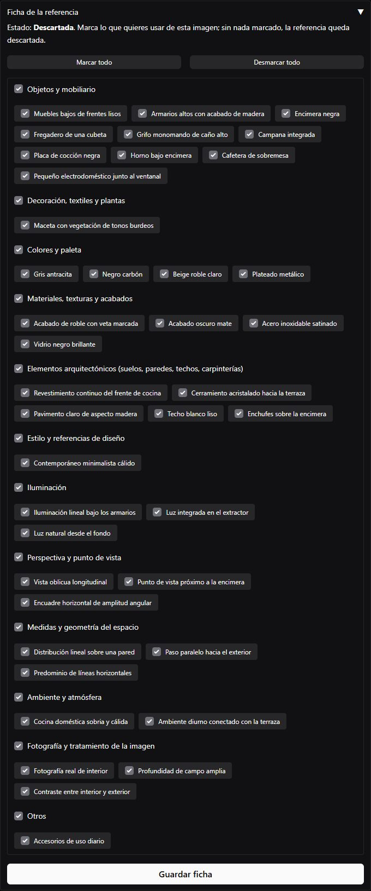{ width="560" }

## Volver a analizar con otras notas

Si el análisis no recoge lo que necesitas, cambia las **notas** y pulsa **Volver a analizar con
estas notas**: la receta se rehace y la ficha se guarda con lo que piden las notas nuevas (es otra
llamada a la IA). **Guardar notas** solo guarda el texto, sin analizar.

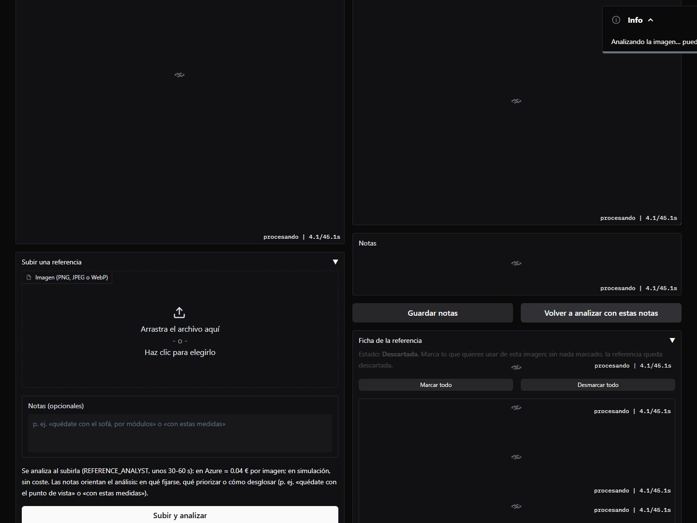

Con la nota «Quédate solo con la iluminación lineal bajo los muebles altos», la referencia quedó
activa con ese único elemento marcado:

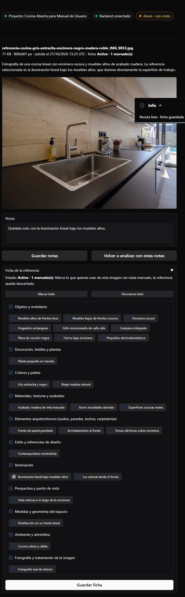{ width="560" }

En el caso se volvió a descartar (**Desmarcar todo** y **Guardar ficha**): la otra foto de la
cocina ya aportaba esa luz.
