# 5. Render final

El render final convierte la composición elegida en una **fotografía realista**. Es la última
etapa: la pestaña se desbloquea cuando hay una composición seleccionada.

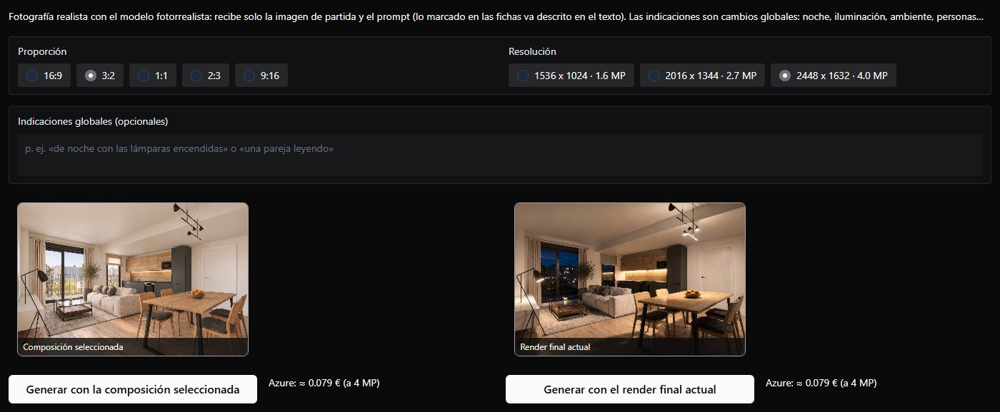

## Lo que recibe el modelo

El modelo fotorrealista recibe **solo la imagen de partida y el prompt**: no ve las referencias.
Lo marcado en las fichas le llega descrito en el texto, y la composición ya fija el espacio, el
mobiliario y los materiales. Por eso las **indicaciones son cambios globales**: el momento del
día, la iluminación, el ambiente o personas en la escena.

## Opciones

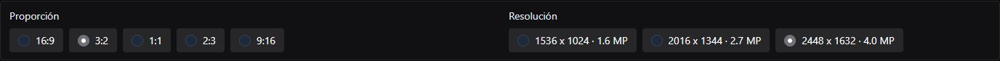

| Opción | Uso |
|--------|-----|
| **Proporción** | 16:9, 3:2, 1:1, 2:3 o 9:16. Por defecto 3:2, la de las composiciones |
| **Resolución** | Tres tamaños por proporción, hasta unos 4 MP; al cambiar la proporción se elige el mayor (aquí, 2448 × 1632). El coste crece con el tamaño |
| **Indicaciones globales** | Opcionales: «de noche con las lámparas encendidas», «una pareja leyendo»… |
| **Generar con la composición seleccionada** | Parte de la composición elegida |
| **Generar con el render final actual** | Parte del render seleccionado, para cambiarle algo conservando lo demás |

Junto a cada botón se ve la estimación del coste (unos 0,08 € a 4 MP).

## Día, atardecer y noche

En el caso se generaron tres renders **con la composición seleccionada**, cambiando solo las
indicaciones:

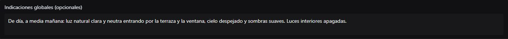

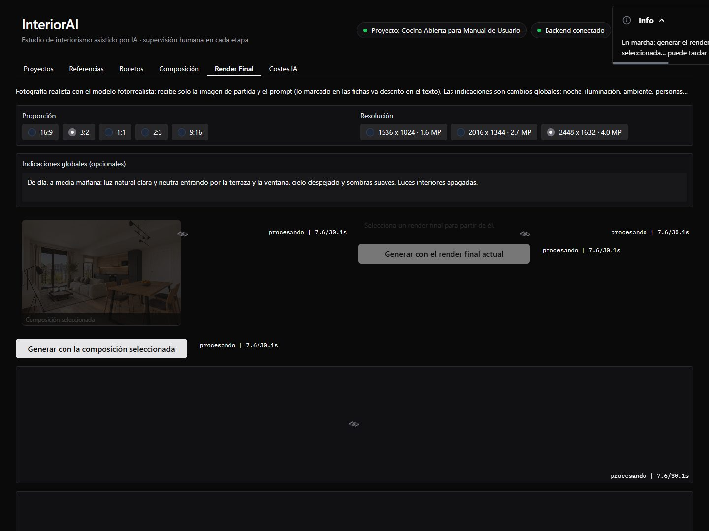

=== "Día"

    > De día, a media mañana: luz natural clara y neutra entrando por la terraza y la ventana,
    > cielo despejado y sombras suaves. Luces interiores apagadas.

    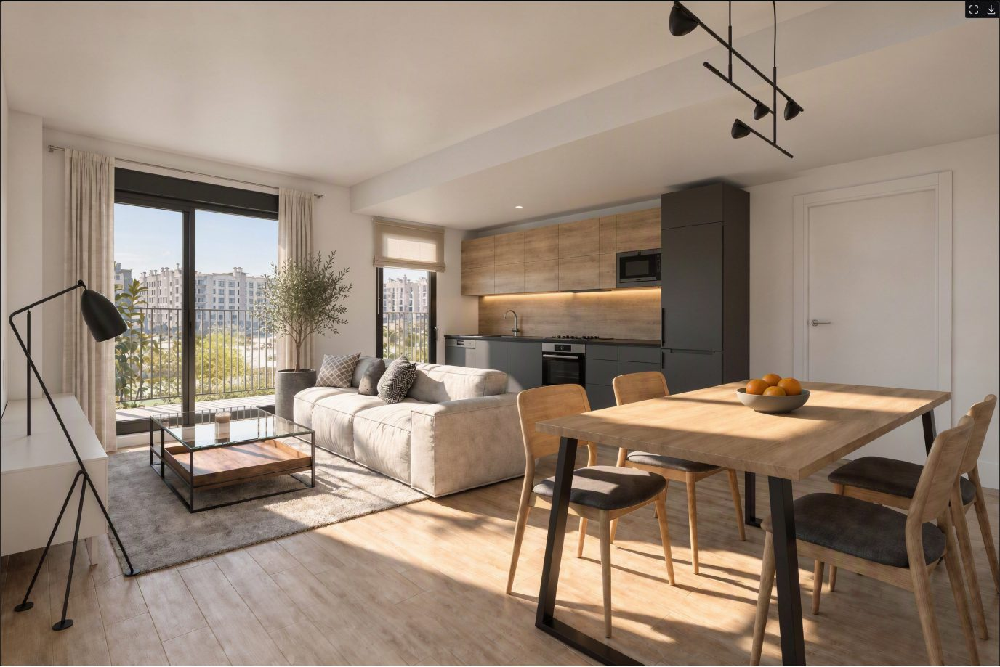

=== "Atardecer"

    > Al atardecer, en la hora dorada: sol bajo y cálido entrando por la terraza, con sombras
    > largas sobre el suelo y reflejos dorados en la madera. Luces interiores apagadas.

    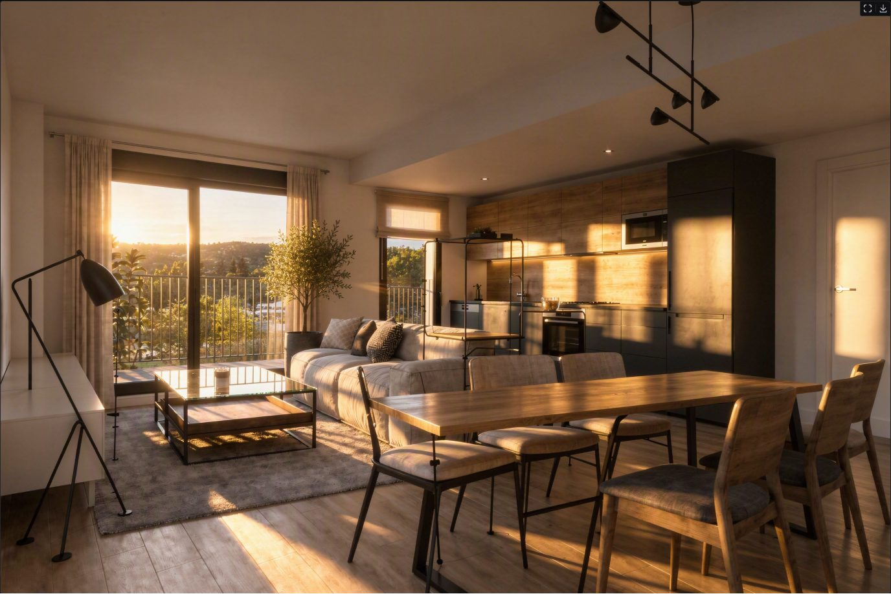

    Este cambió más de la cuenta: alargó la mesa del comedor y añadió una estructura. Es normal
    que alguna generación no salga bien; para eso está **Otra versión** (abajo).

=== "Noche"

    > De noche: cielo azul oscuro y edificios con ventanas iluminadas al fondo. Dentro, luz cálida
    > de unos 2700 K: la tira LED bajo los muebles altos, la lámpara del comedor y la lámpara de
    > pie encendidas, con charcos de luz suaves y ambiente acogedor.

    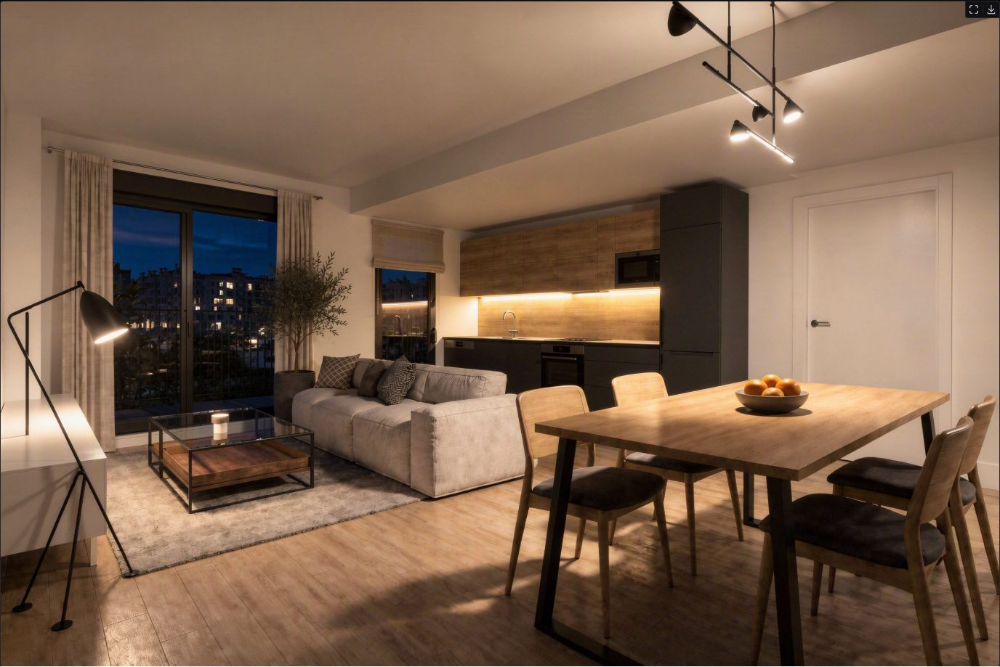

!!! note "Si la IA agota el tiempo"
    El primer intento del render de noche superó el tiempo máximo de espera y terminó con un
    error. **La aplicación no reintenta un tiempo agotado**, porque la llamada pudo facturarse:
    queda en el registro de costes y tú decides si lanzarla otra vez. El segundo intento salió
    bien.

## Otra versión

Con un render seleccionado en la galería, **Otra versión** repite tal cual el prompt, la imagen de
partida y la resolución, sin indicaciones nuevas: el modelo varía el resultado.

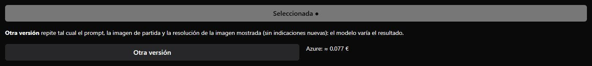

La otra versión del atardecer sí conservó el comedor:

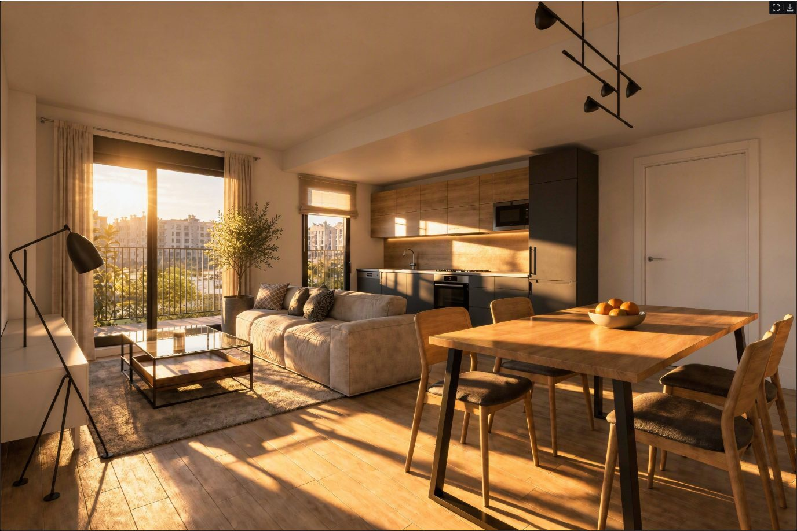

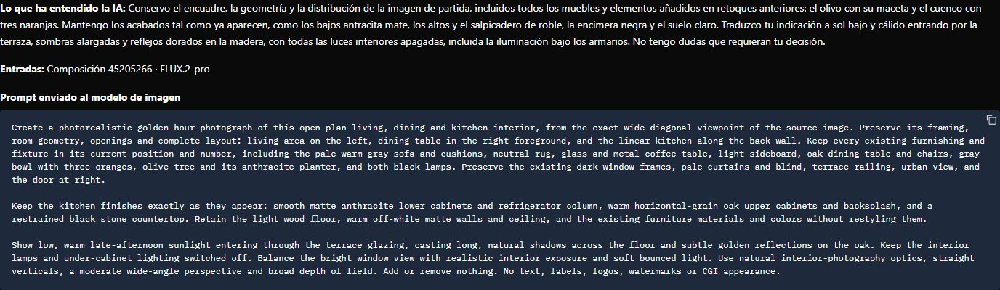

## Desde el render final actual

**Generar con el render final actual** parte del render seleccionado en vez de la composición.
Sirve para cambiar el formato o un detalle sin perder lo conseguido. En el caso, con el de día
seleccionado, en **16:9** y con estas indicaciones:

> Mismo momento del día y la misma luz. Recompón el encuadre en formato panorámico ampliando la
> vista a los lados con naturalidad.

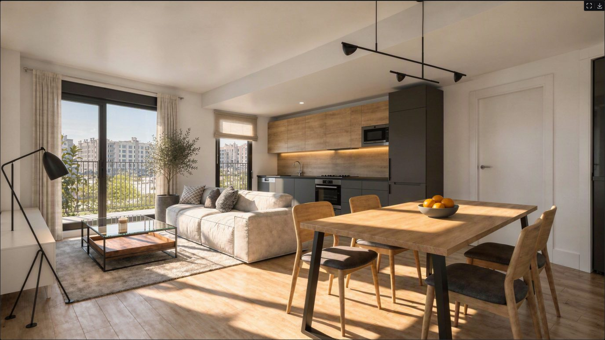

## El render elegido

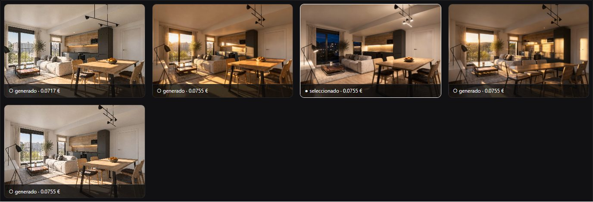

Como en las demás etapas, **Seleccionar** elige el render final; en el caso, el de **noche**. Pasa
a ser la portada del proyecto en la galería de **Proyectos**.

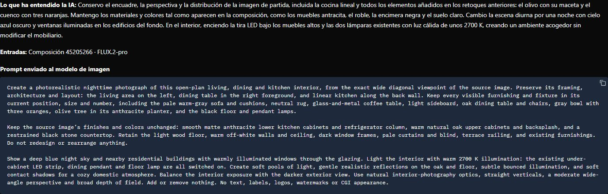

La trazabilidad muestra cómo la IA mantuvo todo lo de la composición (incluidos el olivo del
retoque y el cuenco de naranjas) y solo cambió la luz. Las imágenes enviadas son únicamente la
composición de partida:

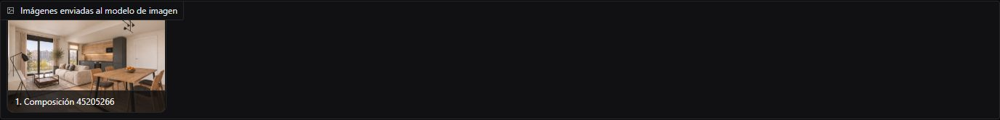

El coste acumulado de la cadena suma ya todo el camino, desde las recetas de las referencias
hasta el render:

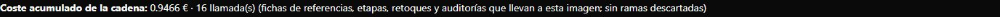
