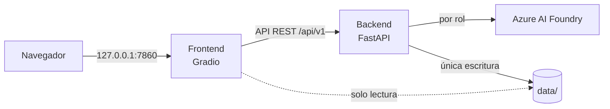
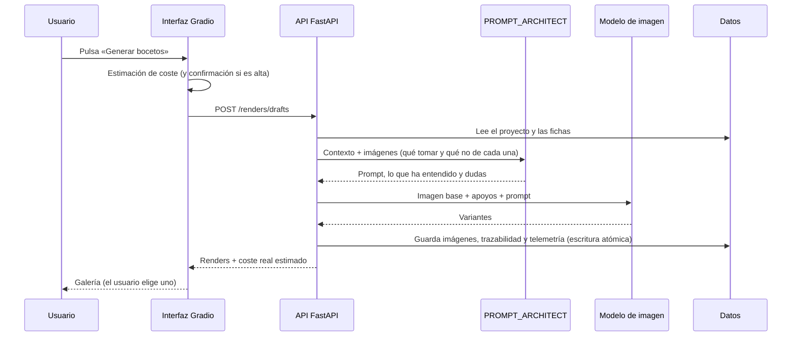

# Arquitectura

## Contenedores

| Contenedor | Tecnología | Responsabilidad |
|------------|------------|-----------------|
| `backend` | Python 3.11, FastAPI (asíncrono) | API REST, almacenamiento, llamadas a la IA, telemetría de costes. Único con credenciales y único que escribe en `data/` |
| `frontend` | Python 3.11, Gradio 6 | Interfaz web en español con tema oscuro. Sin credenciales; lee las imágenes de `data/` en solo lectura y escribe a través de la API |
| `data-init` | La imagen del backend, sin red | Da la propiedad de `data/` al usuario de los contenedores (`APP_UID`) y termina; el backend arranca después |

Los tres comparten el volumen `studio_shared_data`, montado en `./data`. Los puertos solo se
publican en `127.0.0.1`.

## El recorrido de una generación

Así funciona, por ejemplo, «Generar bocetos»:

1. La interfaz muestra una **estimación** antes de pulsar y, en modo Azure, pide un segundo clic
   si supera 0,20 €.
2. El backend reúne las **entradas reales**: la imagen base (la referencia con perspectiva
   marcada), hasta 12 apoyos (primero los del espacio) y lo marcado en cada ficha.
3. El **PROMPT_ARCHITECT** escribe el prompt de esa generación, con el historial de la imagen de
   partida y las generaciones anteriores de la etapa, y devuelve lo que ha entendido y sus dudas.
4. El **modelo de imagen** del rol de la etapa genera las variantes.
5. Todo se guarda con trazabilidad: entradas, prompt, versión del prompt de sistema, coste y la
   petición (`X-Request-ID`) que lo originó. Ninguna imagen queda seleccionada: **elige el
   usuario**.

## Principios de diseño

| Principio | Cómo se cumple |
|-----------|----------------|
| **Supervisión humana** | Las transiciones de estado (seleccionar una imagen) solo ocurren por acción del usuario (`app/hitl/`). Cada etapa exige la imagen seleccionada en la anterior |
| **Única vía a la IA** | Toda llamada pasa por `FoundryClient`, envuelto en un cliente con telemetría que registra tokens, imágenes, latencia y coste estimado |
| **Roles, no modelos** | El código solo conoce roles (`PROMPT_ARCHITECT`, `FAST_DRAFT_MAKER`…); el despliegue de cada uno está en el `.env` |
| **Única escritura en `data/`** | Solo el backend escribe, con escritura atómica (temporal + `fsync` + `os.replace`) bajo un bloqueo por proyecto |
| **Sin sorpresas de coste** | Estimación antes de cada acción, confirmación por encima de 0,20 €, avisos de gasto y un timeout nunca se reintenta (pudo facturarse) |
| **Funciona sin credenciales** | Modo `mock` completo: los tests, la CI y las pruebas de extremo a extremo no llaman a Azure |
| **Mínimo privilegio** | Usuario sin privilegios (uid 1000), sistema de archivos en solo lectura, sin capacidades, límites de memoria y CPU |
| **Sin medidas inventadas** | Lo que no consta va a `null`; una medida estimada se marca como tal; en los prompts, las medidas estándar del mercado van siempre como aproximadas |

## Estructura del código

| Ruta | Contenido |
|------|-----------|
| `shared/src/shared/` | Código común: configuración (`settings.py`), roles (`roles.py`), modelos de dominio (`models.py`), reglas de qué recibe cada generación (`supports.py`) y tamaños (`sizes.py`) |
| `backend/app/api/` | Endpoints (`v1/`), dependencias, errores, subidas y middleware |
| `backend/app/storage/` | Repositorio de proyectos, escritura atómica, bloqueos, papelera, migraciones y CLI |
| `backend/app/foundry/` | Clientes de IA: Azure, simulación, tipos, errores y la prueba real (`smoke`) |
| `backend/app/pipelines/` | Análisis de referencias, prompt automático, etapas de imagen, máscaras, auditoría y prompts de sistema (`prompts/*.md`) |
| `backend/app/telemetry/` | Cliente con telemetría, precios, resúmenes de costes y coste de una cadena |
| `backend/app/hitl/` | Transiciones de estado que solo dispara el usuario |
| `frontend/ui/` | Aplicación Gradio: pestañas, vistas, tema, cliente de la API y previsiones |
| `config/pricing.yaml` | Precios de los despliegues (sin secretos) |
| `postman/` · `e2e/` | Pruebas de la API (Postman) y de la interfaz (Playwright) |
