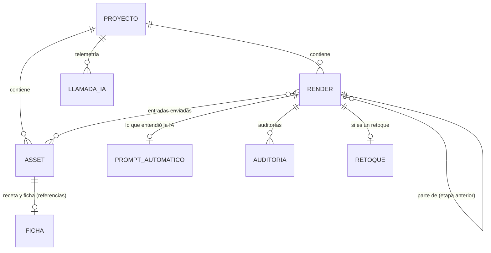

# Datos y almacenamiento

Todo lo que crea InteriorAI vive en la carpeta `data/` de tu equipo. Solo el backend escribe en
ella. Los modelos están definidos con Pydantic en
[`shared/src/shared/models.py`](https://github.com/SergioVelmay/InteriorAI/blob/main/shared/src/shared/models.py)
y rechazan cualquier campo desconocido.

## Modelo de datos



| Modelo | Qué es | Campos principales |
|--------|--------|--------------------|
| `ProjectMetadata` | Un proyecto (un espacio de la casa) | `id`, `name`, `description` (el contexto del diseño), `assets`, `renders`, `schema_version` |
| `Asset` | Una imagen del proyecto: una **referencia** subida o un **render** generado | `kind` (`referencia` o `render`), nombre original, tipo, tamaño, `sha256`, píxeles, `description` (tus notas), `sheet` |
| `ReferenceSheet` | La **receta** de una referencia y lo que marcaste en su **ficha** | `recipe`, `selected` (`"grupo:índice"`), las notas con que se analizó, el despliegue y la petición |
| `ReferenceRecipe` | Lo útil de la imagen en 12 grupos fijos | `summary` y una lista de `RecipeElement` por grupo |
| `RecipeElement` | Un «ingrediente» | `label`, `detail`, `dimensions_cm`, `dimensions_source` (`nota_usuario`, `cota_imagen`, `estimada` o `ninguna`) |
| `RenderRecord` | Una imagen generada, con toda su trazabilidad | `stage`, `status`, `role`, `deployment`, `prompt` exacto, `prompt_info`, `prompt_version`, `input_asset_ids`, `parent_render_id`, `size`, `quality`, `cost_eur`, `audits`, `inpaint`, `request_id` |
| `StagePrompt` | Lo que escribió el PROMPT_ARCHITECT | `prompt` (en inglés), `interpretation` y `open_questions` (en español) |
| `RenderAudit` | Una auditoría de la imagen | `report` (veredicto, puntuación, comprobaciones, desviaciones y correcciones), referencias comparadas, tus observaciones, coste |
| `RenderInpaint` | Un retoque con máscara | imagen retocada, instrucción, archivo de la máscara y fracción pintada |
| `TelemetryRecord` | Una llamada a la IA | rol, despliegue, operación, estado, latencia, tokens, imágenes, megapíxeles, coste estimado, `simulated`, `request_id` |

### Los 12 grupos de la receta

Objetos y mobiliario · Decoración, textiles y plantas · Colores y paleta · Materiales, texturas y
acabados · Elementos arquitectónicos (suelos, paredes, techos, carpinterías) · Estilo y
referencias de diseño · Iluminación · Perspectiva y punto de vista · Medidas y geometría del
espacio · Ambiente y atmósfera · Fotografía y tratamiento de la imagen · Otros.

Una referencia está **activa** si tiene algo marcado en su ficha; solo las activas se usan en el
diseño. La que tiene marcada la perspectiva es la **imagen base** de los bocetos.

### Etapas y estados

| Etapa (`stage`) | Rol | Parte de |
|-----------------|-----|----------|
| `boceto` | `FAST_DRAFT_MAKER` | La referencia con perspectiva y los apoyos |
| `composicion` | `COMPOSITION_BUILDER` | El boceto seleccionado o la composición seleccionada |
| `render_final` | `REALISTIC_RENDERER` | La composición seleccionada o el render final seleccionado |

Cada imagen está `generado` o `seleccionado`, con **una sola seleccionada por etapa**: al
seleccionar otra, la anterior vuelve a `generado`. Solo el usuario selecciona.

## La carpeta `data/`

```text
data/
├── proyectos.json              # índice de proyectos (se repara solo al arrancar)
├── .locks/                     # bloqueos entre procesos
├── .papelera/                  # proyectos e imágenes borrados (recuperables)
└── <id del proyecto>/
    ├── metadatos.json          # el proyecto completo (ProjectMetadata)
    ├── metadatos.v2.json       # copia previa a la última migración de esquema
    ├── costes_telemetria.jsonl # una línea por llamada a la IA
    ├── referencias/            # imágenes subidas: <id>.<ext>
    └── renders_historico/      # imágenes generadas: <id>.png, <id>.json, <id>-mascara.png
```

- Los archivos se guardan con su UUID; el nombre original solo está en los metadatos.
- Cada render tiene, junto a la imagen, un `<id>.json` con su trazabilidad, y los retoques, su
  máscara.
- `proyectos.json` se puede reconstruir siempre a partir de los `metadatos.json`
  (`python -m app.storage reindexar`).

## Escritura segura

- **Atómica:** cada JSON se escribe en un temporal, se fuerza a disco (`fsync`) y se sustituye
  con `os.replace`. Un corte de luz deja el archivo anterior o el nuevo, nunca uno a medias.
- **Bloqueo por proyecto** (`asyncio.Lock` + `filelock`), siempre en el orden proyecto → índice.
- **La telemetría solo se añade** (`costes_telemetria.jsonl`): una línea cortada al final, por un
  corte, se ignora al leer.
- **Al crear un proyecto**, `metadatos.json` se escribe el último: su presencia marca que el
  proyecto está completo.

## Papelera

Borrar un proyecto lo mueve a `.papelera/<id>-<marca>`; borrar una imagen, a
`.papelera/<id>/<marca>-<archivo>`. Se restauran proyectos completos (nunca se sobrescribe uno
existente) y vaciar es definitivo:

```bash
docker compose exec backend python -m app.storage papelera listar
docker compose exec backend python -m app.storage papelera restaurar <entrada>
docker compose exec backend python -m app.storage papelera vaciar --dias 30
```

## Migraciones

Cuando cambia el esquema de `metadatos.json`, el backend migra cada proyecto **al arrancar** y
**al restaurarlo de la papelera**, con una copia previa del original. Es repetible: si se corta,
el siguiente arranque la completa.

| Esquema | Versión | Cambios |
|---------|---------|---------|
| 3 | 4.0.0 | Sin la compatibilidad con la v1: las imágenes de la v1 quedan sueltas, sin brief (copia: `metadatos.v2.json`) |
| 2 | 2.0.0 | Referencias con receta y ficha, prompts automáticos, una imagen seleccionada por etapa |
| 1 | 1.0.0 | Ya no se lee: actualiza antes con la 3.0.0 |
